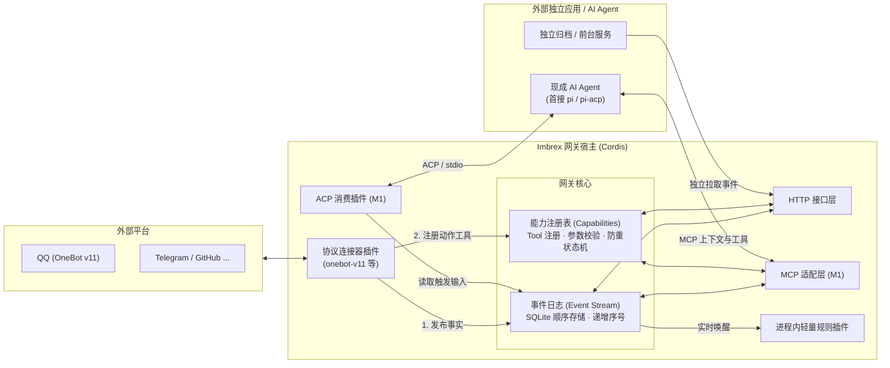

# Imbrex

**A hackable event and capability gateway for apps and agents.**

Imbrex 是一个面向个人数字生活与 AI Agent 的可扩展事件与能力网关。它以现代插件系统为骨骼、以轻量有序日志为血液，将分散在聊天平台、开发工具和本地系统的异构数据汇聚为一条不可变的事实流，并为外部 AI 和应用提供标准、受控的动作工具调用通道。

**当前状态：M0 核心原型可运行，M1 指定范围的真实 QQ → Agent → 回复闭环已验证，M2-01 的协议插件化与基础管理页、M2-02 的只读观测与插件自携前端视图已实现（待独立审核）。** 已提供 SQLite 事件日志、能力调用、HTTP/MCP、Cordis 宿主、OneBot 插件、agent-chat、离线恢复工具与 `web/` 管理前端构建包。真实 pi/模型通过模拟平台回复与不回复，并在 SnowLuma 的指定群完成一次自动回复；实际范围与未覆盖项见[真实验证记录](docs/experiments/m1-live.md)。安装见[开发指南](docs/development.md)，恢复步骤见[M1 运行记录](docs/experiments/m1-operations.md)。

---

## 核心特性

- **不可变事实流（Event Stream）**
  记录客观发生的事实（如收到消息、提交代码）。事件只追加、不修改，通过递增序号回溯与独立重读；产生外部动作时使用单独的能力调用与稳定调用 ID。
- **统一能力面（Capability / Tool Registry）**
  为只读工具和外部动作提供统一的注册与调用通道。通过 JSON Schema 描述参数，保存写调用状态；结果未知时停止自动重发。M1 的 MCP 适配复用同一能力与授权服务。
- **现代插件体系（Cordis Powered）**
  基于 Cordis 提供依赖注入与生命周期管理。HTTP、REST、MCP 与 admin 已由插件提供；`web/` 是纯管理 Shell，不是 Cordis 宿主插件；业务视图由各插件 `client/` 自携 ESM，Shell 按启用插件动态加载并通过 `ctx.views` 装配。业务插件通过受信入口启停并显式清理资源，管理与配置应用遵循各自生命周期。
- **轻重双轨消费模型**
  - **进程内轻量插件**：通过事件钩子实时响应，几十行代码即可实现群消息过滤或简单转发。
  - **进程外独立应用**：应用可通过 HTTP 主动读取并调用工具；M1 的 Agent 通过 MCP 使用网关，agent-chat 插件负责事件触发，Agent 自己管理模型循环和历史。
- **轻量极简，拒绝过度设计**
  无分布式中间件依赖，使用单机 SQLite (WAL)，提供可运行的本地配置与演示。

---

## 系统架构速览

---

## 典型场景

- **智能群聊与消息助手**：通过 OneBot 连接 QQ，实时沉淀群聊与私聊消息，后台 Agent 自主分析语义并按需调用回复工具。
- **个人数字记忆与归档**：汇聚即时通讯、邮件、社交平台与桌面活动，为外部向量检索、知识库和长期记忆系统提供可信原始数据。
- **多 Agent 协同枢纽**：Agent A 将思考过程与阶段性结论作为派生事件发回网关，触发 Agent B 或外部自动化工作流继续接力执行。
- **事件过滤与跨平台桥接**：编写微型 Cordis 插件，监听 GitHub 事件并在过滤后转发至指定群组。

---

## 文档指南

详细的技术架构、协议契约与开发规范请查阅 [`docs/`](docs/) 目录：

- **[统一架构设计](docs/architecture.md)**：系统全貌、分层职责、数据所有权与核心概念。
- **[HTTP 契约规范](docs/contracts.md)**：外部 `/v1` REST API、事件模型、类型映射与错误码定义。
- **[能力与工具系统](docs/capabilities.md)**：能力注册、Schema 校验、调用幂等与状态机设计。
- **[存储与持久化](docs/storage-and-recovery.md)**：SQLite 表结构设计、事务边界与运维备份。
- **[Cordis 插件开发指南](docs/plugins.md)**：插件开发规范、服务注入与连接器模板。
- **[OneBot 与 Agent 接入](docs/onebot-and-agent.md)**：OneBot v11 协议连接与 Agent 闭环指南。
- **[Agent 协议接入](docs/agent-integration.md)**：MCP 工具与上下文、ACP 事件触发，以及 pi/pi-acp 复用边界。
- **[配置与运维指南](docs/operations.md)**：主体鉴权、权限配置、单实例启动与优雅停机。
- **[M1 接入与恢复记录](docs/experiments/m1-operations.md)**：停机恢复命令、模拟证据、真实服务配置与待验范围。

---

## 参与开发与协作

M0 已完成，M1 的连接器、Agent 协议适配和恢复工具已实现。M2 已定稿为全插件化与[管理后台](docs/admin.md)，M2-01 的协议插件、基础管理 API 与前端骨架已实现，其余按观测、控制、打包验收推进；原 observer/第二消费者交付目标取消。工具链、启动命令和当前验证范围见[本地开发指南](docs/development.md)。

本项目遵循规范的工程规范与 Git PR 协作流程：
- 编码前请查阅 **[协作与开发规范 (AGENTS.md)](AGENTS.md)**。
- 本项目原则上**通过 Pull Request (PR) 推进代码合入**，分支规范与审核门禁详见 `AGENTS.md`。
