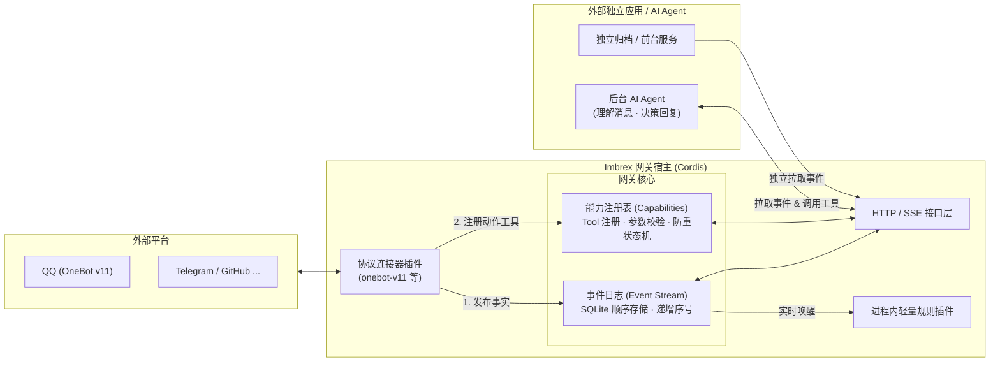

# Imbrex

**A hackable event and capability gateway for apps and agents.**

Imbrex 是一个面向个人数字生活与 AI Agent 的可扩展事件与能力网关。它以现代插件系统为骨骼、以轻量有序日志为血液，将分散在聊天平台、开发工具和本地系统的异构数据汇聚为一条不可变的事实流，并为外部 AI 和应用提供标准、受控的动作工具调用通道。

---

## 核心特性

- **不可变事实流（Event Stream）**
  记录客观发生的事实（如收到消息、提交代码）。事件只追加、不修改，支持通过单调递增的序号安全回溯与多消费者独立重读，杜绝命令与事件混杂带来的副作用重放灾难。
- **统一能力面（Capability / Tool Registry）**
  为产生外部动作的操作（如发送消息、操作 Issue）提供统一的注册与调用通道。通过标准 JSON Schema 描述，天然对齐大模型 **Tool Use / Function Calling / MCP** 规范；内置调用状态机与幂等保护，防止极端网络故障下的盲目重试与群聊刷屏。
- **现代插件体系（Cordis Powered）**
  基于 Cordis 框架构建，提供细粒度的依赖注入（Service）与生命周期管理（Lifecycle）。连接器、过滤规则、HTTP 接口均可作为插件热插拔，资源注销干净彻底。
- **轻重双轨消费模型**
  - **进程内轻量插件**：通过事件钩子实时响应，几十行代码即可实现群消息过滤或简单转发。
  - **进程外独立应用**：后台 Python / TS Agent、长期归档服务通过标准 HTTP/SSE 接口主动拉取事件并调用工具，技术栈完全自由，崩溃互不影响。
- **轻量极简，拒绝过度设计**
  无复杂的分布式中间件依赖，单机 SQLite (WAL) 驱动，开箱即用，极低资源占用。

---

## 系统架构速览

---

## 典型场景

- **智能群聊与消息助手**：通过 OneBot 连接 QQ，实时沉淀群聊与私聊消息，后台 Agent 自主分析语义并按需调用回复工具。
- **个人数字记忆与归档**：汇聚即时通讯、邮件、社交平台与桌面活动，为外部向量检索、知识库和长期记忆系统提供可信原始数据。
- **多 Agent 协同枢纽**：Agent A 将思考过程与阶段性结论作为派生事件发回网关，触发 Agent B 或外部自动化工作流继续接力执行。
- **事件过滤与跨平台桥接**：编写微型 Cordis 插件，监听 GitHub 事件并在过滤后转发至指定群组。

---

## 文档指南

详细的技术架构、协议契约与开发规范请查阅 [`docs/`](docs/) 目录：

- **[统一架构设计](docs/architecture.md)**：系统全貌、分层职责、数据所有权与核心概念。
- **[HTTP 契约规范](docs/contracts.md)**：外部 `/v1` REST API、事件模型、类型映射与错误码定义。
- **[能力与工具系统](docs/capabilities.md)**：能力注册、Schema 校验、调用幂等与状态机设计。
- **[存储与持久化](docs/storage-and-recovery.md)**：SQLite 表结构设计、事务边界与运维备份。
- **[Cordis 插件开发指南](docs/plugins.md)**：插件开发规范、服务注入与连接器模板。
- **[OneBot 与 Agent 接入](docs/onebot-and-agent.md)**：OneBot v11 协议连接与 Agent 闭环指南。
- **[配置与运维指南](docs/operations.md)**：主体鉴权、权限配置、单实例启动与优雅停机。

---

## 参与开发与协作

工程初始化已完成，工具链、安装命令和当前验证范围见[本地开发指南](docs/development.md)。网关运行时与平台连接器仍在后续开发计划中。

本项目遵循规范的工程规范与 Git PR 协作流程：
- 编码前请查阅 **[协作与开发规范 (AGENTS.md)](AGENTS.md)**。
- 本项目原则上**通过 Pull Request (PR) 推进代码合入**，分支规范与审核门禁详见 `AGENTS.md`。
