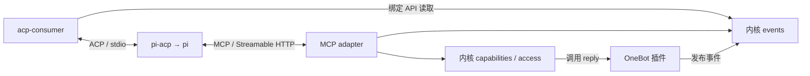

# Agent 接入：MCP 与 ACP

统一开发基线 0.3 · 2026-10-19。**本文件规定 M1 的已选方案，协议适配与 pi 联调尚未实现。** M0 现有 HTTP 与插件 API 继续有效；具体任务见[开发计划](development-plan.md#m1)。

## 1. 模块与协议职责

| 模块 | 角色 | 职责 |
| --- | --- | --- |
| `src/plugins/onebot-v11/` | 平台连接器插件 | 接纳事件、注册 `<instance>.reply`，将能力调用转成标准 OneBot Action |
| `src/adapters/mcp/` | MCP Server | 让 Agent 查询网关上下文、发现获授权能力、调用并查询结果 |
| `src/plugins/acp-consumer/` | 普通 Consumer 插件、ACP Client | 主动读事件、筛选触发、管理协议会话关联与最少消费状态 |
| pi + pi-acp（首接组合） | ACP Agent 端、MCP Client | 模型循环、工具选择、上下文、Agent 历史与会话恢复 |

Consumer 是已有应用消费角色的具体插件；不再增加 Runner 或通用 Agent 运行时。MCP 承担上下文和工具交互，ACP 承担提交输入、会话更新与终止；不依靠 MCP 通知证明 Agent 已接手一条事件。

具体插件先放在上述源码目录，同一 npm 工程管理。更换兼容 Agent 通过配置 ACP 程序并验证协议能力，不为每个模型/Agent 创建一套 Imbrex 插件；需要单独发布时再提取 package。

## 2. MCP 入口与暴露范围

M1 在现有 HTTP 监听上提供 `/v1/mcp` Streamable HTTP 端点。adapter 在进程内直接复用 core 的 events、capabilities、access，保持 core 不依赖 MCP、Cordis 或 HTTP 框架。上下文与动作使用同一个 MCP Server。

首版只实现这条已有消费者需要的传输，MCP stdio 和 MCP→Imbrex HTTP 回环桥接不列入 M1。MCP 传输即使使用 SSE，也不等于新增网关事件订阅或 ACK。采用现成协议 SDK；M1-02 核验并锁定所用版本，在实现中同步补齐具体工具/资源名称、schema 和错误映射。[R12](references.md#r12)

| 交互 | 复用的责任边界 |
| --- | --- |
| 实例信息、事件分页与按引用查询 | 现有 info/read/lookup；来源读取授权、store_id 与十进制序号不变 |
| 能力发现 | 只列当前主体获授权且可用的能力，参数 schema 来自现有注册 |
| 能力调用 | 再次校验主体、能力、参数与外部写开关；reply 的目标由可信原事件得出 |
| 调用结果查询 | 使用稳定 call_id，只读本主体记录；保留 in_progress/succeeded/failed/unknown |

只读查询可映射为 Tools，适合资源读取的上下文可映射为 Resources；按 pi 演示实际需要实现，不强制给同一操作提供两套入口。事件正文及其元数据受既有来源授权限制；info 的 store_id/latest_seq 沿用单所有者共享规则。原始 OneBot Actions 不整体映射成工具，`qq-main` 只是实例示例名，通用内核与 MCP 不写死它。

首版沿用静态 bearer token 与 Principal 配置；外部 Agent 使用专用主体。每个请求重新鉴权，MCP session ID 不能替代认证或在主体间复用。发现过滤和真正执行同时受核心授权约束，不能仅靠隐藏名称或模型提示限制工具；暂不另建权限中间层。[主体配置](operations.md)仍是唯一授权来源。

外部写的 MCP 调用必须携带 store_id、稳定 call_id 与能力参数，结果回显可查询的调用身份与核心状态。MCP 请求 ID 不充当 call_id，收到协议成功响应不等于动作成功；响应丢失后查原调用，unknown 不换 ID 自动补发。

实现遵守传输的初始化、版本协商和 Origin 校验，复用既有限额并有界清理连接/会话。M1 的静态凭据部署不包含通用 OAuth 授权服务；远程部署仍遵守现有 TLS 与凭据要求。

## 3. ACP stdio 接入

M1 由 acp-consumer 使用配置中的可执行文件、参数和工作目录启动 ACP 程序，通过 stdio 交换 JSON-RPC。首接程序为 pi-acp，复用其到 `pi --mode rpc` 的适配。ACP 官方传输资料列有 stdio，Streamable HTTP 仍为草案；没有当前消费者就不预建 HTTP 传输类或可替换传输框架。[R13](references.md#r13) [R14](references.md#r14)

先完成 initialize 与能力协商，仅声明真正实现的客户端能力。通过 `session/new` 获得 Agent 分配的 sessionId，再用 `session/prompt` 提交 prompt 内容块数组；`session/update` 是过程更新，最终响应的 `end_turn` 才是正常一轮结束。[R13](references.md#r13)

平台会话与 ACP sessionId 的映射由 Consumer 保存，Agent 保存历史。重启后只有经协商且实际支持的 session/load 或 resume 成功后才能继续使用旧会话；恢复失败暂停并报告。没有恢复能力时由操作者明确新会话策略，不把旧 ID 直接发给新进程，也不自动恢复未决 prompt。

客户端请求必须有界响应。首版不提供不需要的文件系统/终端委托；收到权限请求时只按显式配置和可核验的请求内容处理，未支持或无法确认的请求拒绝并记录。不能凭工具标题、Agent 声称的 MCP 名称或消息正文自动批准，也不允许无限等待交互式确认。

ACP 权限交互不构成整个 Agent 的沙箱。pi-acp 当前说明 pi 直接使用本地文件与执行能力；MCP 授权只约束 Imbrex 能力，部署时需选择合适的 Agent 工作目录与执行权限，不宣称 Consumer 能拦截全部本地工具。[R14](references.md#r14)

插件拥有自己创建的进程、标准流、计时器和监听器。响应 api.signal 时停止投递，取消/结束当前请求并保留未决标记，关闭资源、终止并回收拥有的进程。验证 pi-acp 及其 pi 后代的退出行为与升级终止路径，不将“已发 SIGTERM/SIGKILL”当作全部清理完成；锁描述符不得泄漏给后代。stderr 可用于脱敏日志，不仅因它有输出就认定进程失败。

## 4. pi 的 MCP 配置与两阶段演示

先运行小型 OneBot 模拟服务、Imbrex 与人工驱动的真实 pi，证明事件查询和 reply 能经过 MCP 到达 OneBot Action；再加入 ACP Consumer 自动触发。模拟服务提供已知事件和可核验的 Action 接收记录，不模拟整个聊天产品。

pi-acp 当前未把 ACP 的 mcpServers 参数接通到 pi，因此首接通过 pi 自身配置连接 Imbrex。核验到的原生 MCP 配置入口为用户级 `~/.pi/agent/mcp.json` 或项目级 `.pi/mcp.json`；项目配置还受其项目信任规则约束。使用环境变量引用 Imbrex 的专用 Principal token，不将凭据写进仓库。[R14](references.md#r14)

M1-03/M1-04 需记录实际 pi、pi-acp、协议 SDK 和模型配置的版本/范围，证明运行中的 Agent 确实发现并能使用 Imbrex 工具。上游 README 的兼容声明和当前文档观察不等于已在本项目验证；不能只填写 mcpServers 就宣告联通。

正常自动运行、in_flight 的持久保存、异常暂停及人工恢复，统一以[应用消费](applications.md)为准。远程 ACP、并发调度和持久任务平台在有实际需求时另行设计。
