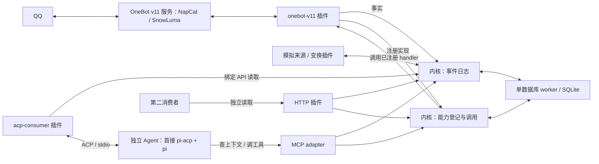

# 系统设计

统一开发基线 0.3 · 2026-10-19。本文规定本方案的架构；M0、M1-01 OneBot、M1-02 MCP 与 M1-04 ACP Consumer 已实现，真实 pi/模型与 SnowLuma 指定群的单次自动回复已通过，实际范围见[实测记录](experiments/m1-live.md)。状态与阅读顺序见[入口](README.md)。

## 1. 产品目标

把来源接入、可重读事件与可调用工具放进一个易扩展的网关，让独立应用组合使用。第一条真实链路是 QQ 消息经 OneBot v11 服务进入、Agent 读取并分析、Agent 按需调用回复能力；第一版同时提供模拟来源、变换和观察插件。

内核不编排模型思考、不管理通用工作流，也不把归档或记忆做成固定角色。应用可以发布派生事件；其他应用按自己的进度消费。插件是本地代码装配方式，外部应用是同等有效的接入方式。

## 2. 组件与数据流



Cordis 根上下文装配内核服务适配、HTTP 与 MCP adapter 及业务插件。MCP 挂载到现有 HTTP 监听并直接调用内核。M1 的 acp-consumer 通过 stdio 启动独立 Agent 进程；其他外部应用仍可通过 HTTP 接入，远程 ACP 不在本阶段。

事件路径：连接器校验和映射原生事实 → 内核提交事件 → 返回接纳回执 → 尝试通知读取者。动作路径：鉴权与参数校验 → 保存调用记录 → 调用明确提供者 → 保存结果。两条路径没有跨平台共同事务。

## 3. 内核独立实现，经薄插件适配装配

| 模块 | 拥有的职责 | 对外边界 |
| --- | --- | --- |
| 内核 events | 接纳、身份去重、位置、读取 | 事件与存储行为及 HTTP 契约 |
| 内核 capabilities | 登记、校验、授权、调用记录及分发 | 能力契约中的行为；平台细节由 handler 实现 |
| 内核 access | 主体、来源范围和能力授权 | HTTP、MCP 与插件入口共同使用 |
| SQLite worker | 短事务、持久数据与迁移版本 | 只接受内核定义的命令，不向插件暴露 SQL |
| Cordis 适配 | 创建内核、绑定插件服务、清理资源 | [插件接口](plugins.md) |
| HTTP 插件 | 鉴权、校验、序列化、状态码 | 不另写事件/调用业务规则 |
| MCP adapter | 按主体映射上下文与能力 | `/v1/mcp` Streamable HTTP，直接复用内核服务 |
| 平台插件 | 连接、身份映射、平台操作与可用性 | 使用内核接口，拥有自己的连接状态 |
| acp-consumer 插件 | 筛选触发、ACP 会话关联、进度与未决输入 | 绑定 API 读事件，ACP stdio 提交输入；不实现模型循环 |
| Agent | 上下文、模型、工具选择和 Agent 历史 | 首接复用 pi/pi-acp，通过 MCP 使用网关；内核不依赖具体 Agent |

内核服务是必需组件，启动失败则整个实例启动失败，首版不提供运行中卸载或热替换。业务插件失败可以被报告并停止；声明为 required 的插件失败影响整个实例就绪，optional 插件失败只形成降级。

来源和变换插件都可依赖日志服务，但变换插件不因读取 QQ 历史而依赖 OneBot 服务在线。服务依赖用于装配，事件选择用于业务，分别维护。

## 4. 数据所有权和成功点

| 数据/行为 | 权威位置 | 成功表示 |
| --- | --- | --- |
| 原生消息及平台操作 | 来源平台与连接器协议 | 只按实际支持的接口报告 |
| 事件接纳 | 网关 SQLite | 本次事务已提交，身份和位置可查询 |
| 读取候选位置 | 本页网关读取视图 | 此范围可由应用按自己的责任提交 |
| 应用处理进度 | 应用本地状态 | 依应用策略保存完成前缀与责任；ACP Consumer 单独保留未决输入 |
| 发送意图与查询结果 | 网关调用表 | 对某一主体的稳定调用意图有明确记录 |
| 远端发送 | 平台响应及可关联证据 | 成功只到连接器定义的响应含义，不包含对方已读 |
| 临时通知 | 进程内内存 | 提示有数据；不证明应用已经接手 |

一个应用暂停不改变另一个应用的进度。内核不拥有消费者 ACK、租约、待投递清单或自动交付保证。

ACP Consumer 在提交 prompt 前持久保存 in_flight；未确认结束时暂停，不自动重放。正常 end_turn 只结束 Agent 这一轮，不替代核心调用结果。恢复规则见[应用消费](applications.md)。

## 5. 技术栈和第一轮验证版本

| 项 | 本方案选择 | 进入实现时的要求 |
| --- | --- | --- |
| 语言/模块 | TypeScript、ESM | 严格类型检查；ESNext/Bundler 解析，编译输出由 Node 运行，原因见工程基线 |
| Node | 24.22.0；npm 11.19.1 | 已锁定并运行前置探针 |
| 插件宿主 | cordis 4.0.0-rc.11 | 依赖已锁定，基础探针与 M0 宿主生命周期验证通过 |
| 数据库 | node:sqlite，WAL、FULL 同步 | worker 串行短事务；启用整数读取控制 |
| Schema | Ajv 8.20.0、Draft 2020-12 的限定子集 | 输入不变性探针通过；不启用网络取 schema |
| 编译器 | TypeScript 5.9.3 | 与 Node/ws 类型依赖一起锁定并通过检查 |
| OneBot WS 客户端 | ws 8.22.0 | 超时、释放、限额及发送结果分类通过模拟；SnowLuma 指定群正常单次收发通过 |
| 单实例启动 | Linux util-linux flock 包装 | 非阻塞排他锁、实际宿主持锁，验证崩溃后释放 |

上述组合已通过 M0-01 的类型检查、编译和 4 项依赖风险探针，实际版本及范围见[工程基线](development.md)。后续宿主与内核验证见[M0 运行验收](experiments/m0-runtime.md)，不代表 OneBot 或 Agent 接入已验证。node:sqlite 在参考 Node 文档中仍标为 release candidate。来源与限制见[技术依据](references.md)。后续发现兼容问题时，在保持契约的前提下处理具体依赖问题。

## 6. 首版的可靠性范围

正常进程重启保持 store_id、事件和调用记录。恢复旧备份、更换数据目录、删除存储需要显式管理，不能透明继承应用进度。外部写处于 unknown 时停止自动重发，允许暂时未回复。

同进程插件是受信代码，共享内存和故障域；接口授权防止正常使用中的越权，不构成恶意代码沙箱。死循环、进程退出或内存耗尽可能影响整个宿主。更强隔离由外部应用/部署承担。

保存事件不自动解决来源离线期间的采集；保存调用意图不自动解决平台发送幂等；保存本地数据库不自动解决设备损毁。第一版测试分别验证相应边界。

## 7. 代码组织

```text
src/
  core/             事件、能力、授权和共享领域类型
  storage/          SQLite worker、内部命令和迁移
  host/             Cordis 装配、配置、插件状态
  adapters/http/    HTTP 参数与输出转换
  adapters/mcp/     MCP 上下文与能力映射（M1）
  plugins/          fixture、transform、mock、observer
    onebot-v11/     OneBot v11 连接器与 reply（M1）
    acp-consumer/   ACP Client、输入筛选和消费状态（M1）
  clients/          HTTP 客户端与位置持久化辅助
  cli/              启动、配置检查与本地诊断入口
examples/          运行配置、插件模板；M1 补充 pi 接入演示
test/              对应 T01—T09 的必要测试
```

M0 已实现 core、storage、host、adapters/http、plugins、cli 及对应测试；examples/plugins 提供编译模板，examples/demo.json 提供运行配置。独立 clients 随实际需求创建。M1 在同一工程内实现上述具体目录，复用现成 Agent，不预先发布多个包或增加 Runner、决策引擎和第二套插件运行时。协议职责见 [Agent 接入](agent-integration.md)。

## 8. 协议连接器与具体实现

onebot-v11 是 Imbrex 插件，NapCat、SnowLuma 等是它对接的服务实现。标准事件/动作和通用 WS 路径优先复用；实现特有扩展只在有实际需求与测试后增加兼容适配。不导入服务私有 SDK，不将实现名写入通用内核或 Agent 工具协议。

首版 OneBot v11 仅用于明确的 QQ 子集；其他来源可通过自己的插件直接接入内核。切换实现的身份连续性与兼容状态见 [OneBot 接入](onebot-and-agent.md)。
