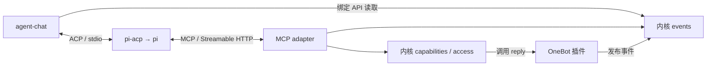

# Agent 接入：MCP 与 ACP

统一开发基线 0.3。本页规定 MCP 暴露与授权、ACP stdio 接入、pi/pi-acp 接缝与生命周期。阶段安排见[开发计划](../progress/plan.md#m1)。

MCP 位于 plugins/adapter-mcp，Consumer 名称为 agent-chat（原 acp-consumer）。模块迁移不改变 MCP 工具、ACP 协议及既有数据绑定；第 5 节为托管配置与受控重启的 M2 目标。

## 1. 模块与协议职责

| 模块 | 角色 | 职责 |
| --- | --- | --- |
| `src/plugins/onebot-v11/` | 平台连接器插件 | 接纳事件、注册 `<instance>.reply`，将能力调用转成标准 OneBot Action |
| `src/plugins/adapter-mcp/` | MCP Server | 让 Agent 查询网关上下文、发现获授权能力、调用并查询结果 |
| `src/plugins/agent-chat/` | 普通 Consumer 插件、ACP Client | 主动读事件、筛选触发、管理协议会话关联与最少消费状态 |
| pi + pi-acp（首接组合） | ACP Agent 端、MCP Client | 模型循环、工具选择、上下文、Agent 历史与会话恢复 |

Consumer 是已有应用消费角色的具体插件；不再增加 Runner 或通用 Agent 运行时。MCP 承担上下文和工具交互，ACP 承担提交输入、会话更新与终止；不依靠 MCP 通知证明 Agent 已接手一条事件。

具体插件先放在上述源码目录，同一 npm 工程管理。更换兼容 Agent 通过配置 ACP 程序并验证协议能力，不为每个模型/Agent 创建一套 Imbrex 插件；需要单独发布时再提取 package。

## 2. MCP 入口与暴露范围

M1 在现有 HTTP 监听上提供 `/v1/mcp` Streamable HTTP 端点。adapter 在进程内直接复用 core 的 events、capabilities、access，保持 core 不依赖 MCP、Cordis 或 HTTP 框架。上下文与动作使用同一个 MCP Server。

首版只实现这条已有消费者需要的传输，MCP stdio 和 MCP→Imbrex HTTP 回环桥接不列入 M1。使用官方 @modelcontextprotocol/sdk 1.32.1，SDK 处理初始化、版本协商与 JSON-RPC；MCP 传输不新增网关事件订阅或 ACK。具体工具和运行证据见下文与[MCP 验证记录](../progress/validation.md#9-证据索引)。[R12](../ops/references.md#r12)

| 交互 | 复用的责任边界 |
| --- | --- |
| 实例信息、事件分页与按引用查询 | 现有 info/read/lookup；来源读取授权、store_id 与十进制序号不变 |
| 能力发现 | 只列当前主体获授权且可用的能力，参数 schema 来自现有注册 |
| 能力调用 | 再次校验主体、能力、参数与外部写开关；reply 的目标由可信原事件得出 |
| 调用结果查询 | 使用稳定 call_id，只读本主体记录；保留 in_progress/succeeded/failed/unknown |

只读查询可映射为 Tools，适合资源读取的上下文可映射为 Resources；按 pi 演示实际需要实现，不强制给同一操作提供两套入口。事件正文及其元数据受既有来源授权限制；info 的 store_id/latest_seq 沿用单所有者共享规则。原始 OneBot Actions 不整体映射成工具，`qq-main` 只是实例示例名，通用内核与 MCP 不写死它。

首版沿用静态 bearer token 与 Principal 配置；外部 Agent 使用专用主体。每个请求重新鉴权，MCP session ID 不能替代认证或在主体间复用。发现过滤和真正执行同时受核心授权约束，不能仅靠隐藏名称或模型提示限制工具；暂不另建权限中间层。[主体配置](../ops/operations.md)仍是唯一授权来源。

外部写的 MCP 调用必须携带 store_id、稳定 call_id 与能力参数，结果回显可查询的调用身份与核心状态。MCP 请求 ID 不充当 call_id，收到协议成功响应不等于动作成功；响应丢失后查原调用，unknown 不换 ID 自动补发。

实现遵守传输的初始化、版本协商和 Origin 校验，复用既有限额并有界清理连接/会话。M1 的静态凭据部署不包含通用 OAuth 授权服务；远程部署仍遵守现有 TLS 与凭据要求。

### 2.1 工具清单

tools/list 按每次请求的主体权限过滤以下工具。能力清单由 imbrex_list_capabilities 返回，只包含当前获授权且可用的核心注册，保留其完整 input_schema；schema 的根可以是数组、标量或对象。使用固定调用工具避免修改核心能力名称约束，也无需为每个插件手写 MCP schema。

| MCP 工具 | 必填参数 | 可选参数 / 对应结果 |
| --- | --- | --- |
| imbrex_info | 无 | 与 HTTP info 一致的 store_id、latest_seq 和 features |
| imbrex_read_events | store_id、after_seq | limit、source_prefix、type；与 HTTP 读取页一致 |
| imbrex_lookup_event | store_id、source、id | 返回 store_id、record |
| imbrex_list_capabilities | 无 | 返回 store_id、capabilities，字段与 HTTP 能力发现一致 |
| imbrex_invoke | store_id、capability_id、params | 外部写必填 call_id，只读能力省略；返回核心 result 或 call |
| imbrex_get_call | store_id、call_id | 返回本主体的核心 call；原插件离线后仍可查 |

参数 schema 由 tools/list 提供，未知业务参数拒绝；store_id 为字符串，位置是规范十进制字符串，limit 是 1—100 的整数。字符串、JSON 大小与深度限制沿用 HTTP 契约。SDK 转换前检查原始工具请求，业务 schema 校验使用保留的原始 arguments，不因 SDK 删除字段而放行非法请求。工具发现只是一份当前视图，执行重新检查权限、存储身份、参数与提供者状态，不凭模型提示授权。没有事件写入、原始 OneBot Action 或任意收件人工具。

工具响应的 content 文本与 structuredContent 提供相同 JSON。核心错误返回 isError=true 和 error.code/message、request_id；外部写结果为 failed、unknown 或 in_progress 时也标记 isError=true，并保留完整 call。查询未知调用成功仅表示查询成功，必须继续检查 call.status；不能从 MCP 协议成功或查询的 isError=false 推断远端发送成功。

### 2.2 传输、认证与清理

采用官方 SDK 的 stateless 模式，每次 POST 创建独立 Server/transport，返回 JSON。客户端正常执行 initialize、notifications/initialized 和后续工具请求；SDK 协商初始化版本，校验后续 MCP-Protocol-Version，未携带版本时使用 SDK 的 2025-03-26 兼容默认。服务端不保存客户端初始化状态，不生成 MCP session ID，身份始终来自当前请求的 Bearer 凭据。

POST 的 Accept 须包含 application/json 与 text/event-stream；初始化后的通知返回 202。GET、DELETE 等其他方法返回 405/Allow: POST；MCP session ID、Last-Event-ID 与批请求拒绝，不提供恢复流、资源订阅或 MCP Tasks。鉴权、Origin、HTTP 请求体失败沿用 HTTP 错误结构；SDK 处理的协议失败使用 JSON-RPC 错误，业务失败使用上节的工具结果。

无 Origin 的本地 CLI 请求可用；携带 Origin 时必须精确等于配置监听地址与实际端口构成的 HTTP origin，不能借请求 Host 头放行其他网站。首接 CLI 不需要额外浏览器跨域配置。请求体最多 256 KiB、JSON 深度最多 32、活跃 HTTP 数据请求最多 32、核心并发 handler 最多 8，所有限制与 REST 共用。

响应完成或客户端断开后关闭该请求的协议实例。已经开始的核心调用继续保存结果，占用的请求预算在收尾完成后释放；断开不触发自动重试或回滚。宿主停用时沿用核心 drain 与 HTTP 关闭流程。

## 3. ACP stdio 接入

当前使用官方 @agentclientprotocol/sdk 1.9.0 的 ACP v1 接口，运行配置与验证证据见 [ACP Consumer 记录](../progress/validation.md#9-证据索引)。

M1 由 acp-consumer 使用配置中的可执行文件、参数和工作目录启动 ACP 程序，通过 stdio 交换 JSON-RPC。首接程序为 pi-acp，复用其到 `pi --mode rpc` 的适配。ACP 官方传输资料列有 stdio，Streamable HTTP 仍为草案；没有当前消费者就不预建 HTTP 传输类或可替换传输框架。[R13](../ops/references.md#r13) [R14](../ops/references.md#r14)

先完成 initialize 与能力协商，仅声明真正实现的客户端能力。通过 `session/new` 获得 Agent 分配的 sessionId，再用 `session/prompt` 提交 prompt 内容块数组；`session/update` 是过程更新，最终响应的 `end_turn` 才是正常一轮结束。[R13](../ops/references.md#r13)

平台会话与 ACP sessionId 的映射由 Consumer 保存，Agent 保存历史。重启后只有经协商且实际支持的 session/load 或 resume 成功后才能继续使用旧会话；恢复失败暂停并报告。没有恢复能力时由操作者明确新会话策略，不把旧 ID 直接发给新进程，也不自动恢复未决 prompt。

客户端请求必须有界响应。首版不提供不需要的文件系统/终端委托；收到权限请求时只按显式配置和可核验的请求内容处理，未支持或无法确认的请求拒绝并记录。不能凭工具标题、Agent 声称的 MCP 名称或消息正文自动批准，也不允许无限等待交互式确认。

ACP 权限交互不构成整个 Agent 的沙箱。pi-acp 当前说明 pi 直接使用本地文件与执行能力；MCP 授权只约束 Imbrex 能力，部署时需选择合适的 Agent 工作目录与执行权限，不宣称 Consumer 能拦截全部本地工具。[R14](../ops/references.md#r14)

插件拥有自己创建的进程、标准流、计时器和监听器。响应 api.signal 时停止投递，取消/结束当前请求并保留未决标记，关闭资源、终止并回收拥有的进程。验证 pi-acp 及其 pi 后代的退出行为与升级终止路径，不将“已发 SIGTERM/SIGKILL”当作全部清理完成；锁描述符不得泄漏给后代。stderr 可用于脱敏日志，不仅因它有输出就认定进程失败。

Linux 实现依赖 PATH 中的 tini 0.19.0，以 tini -s 包裹监督进程；孤儿后代会被专属 subreaper 接管，避免只追踪原进程组而遗漏 detached 子进程。监督进程确认清理结束后才退出；包括 tini 在内的进程均不继承实例锁。ACP SDK 的过程通知被过滤，错误信封与未知响应 ID 被拒绝，不让库的默认异常日志输出原始数据。[R15](../ops/references.md#r15)

## 4. pi 的 MCP 配置与两阶段演示

已实际运行 pi 1.3.0 的 MCP 发现与 pi-acp 0.0.34 的 initialize。配置、可执行连接检查、回复/不回复演示材料和已验证范围见[pi 接入记录](../progress/validation.md#9-证据索引)。后续已通过指定真实模型的模拟平台回复/不回复，以及指定 QQ 群的单次 ACP 自动回复，见[实测记录](../progress/validation.md#9-证据索引)。

先运行小型 OneBot 模拟服务、Imbrex 与人工驱动的真实 pi，证明事件查询和 reply 能经过 MCP 到达 OneBot Action；再加入 ACP Consumer 自动触发。模拟服务提供已知事件和可核验的 Action 接收记录，不模拟整个聊天产品。

pi-acp 当前未把 ACP 的 mcpServers 参数接通到 pi，因此首接通过 pi 自身配置连接 Imbrex。核验到的原生 MCP 配置入口为用户级 `~/.pi/agent/mcp.json` 或项目级 `.pi/mcp.json`；项目配置还受其项目信任规则约束。使用环境变量引用 Imbrex 的专用 Principal token，不将凭据写进仓库。[R14](../ops/references.md#r14)

M1-03/M1-04 需记录实际 pi、pi-acp、协议 SDK 和模型配置的版本/范围，证明运行中的 Agent 确实发现并能使用 Imbrex 工具。上游 README 的兼容声明和当前文档观察不等于已在本项目验证；不能只填写 mcpServers 就宣告联通。

正常自动运行、in_flight 的持久保存、异常暂停及人工恢复，统一以[应用消费](applications.md)为准。远程 ACP、并发调度和持久任务平台在有实际需求时另行设计。

## 5. M2 托管 pi 配置与受控重启

agent-chat 在 Imbrex 专属数据目录中管理独立的 Agent 工作目录、PI_CODING_AGENT_DIR 与 HOME，后者也隔离 pi-acp 的用户级会话映射。只修改托管实例，不改用户全局 pi 配置。使用已验证的进程 cwd 和环境变量入口，不假定 pi-acp 存在 --cwd 参数，也不假定它已采用 ACP mcpServers。

Admin 集中展示模型、上下文窗口声明、系统提示词、MCP 地址、凭据引用、环境传递情况和 Consumer filter。MCP 地址及静态凭据引用与实际监听/主体配置同步生成，真实秘密不进入前端返回值。独立会话并不自动提供独立读取授权，面板须如实展示当前主体的可读范围。

模型选择、上下文窗口和系统提示词在 M2-03 可编辑。保存后显示“已保存，待重启生效”，不能当作已经加载。当前轮继续使用旧配置；空闲且无异常未决项时，暂停下一条输入，仅停止并重启 pi-acp/pi，完成 ACP 握手和必要的 session/load 后继续。Imbrex 宿主、REST/MCP、OneBot WebSocket 和其他插件保持运行。

受控重启保留 store_id、last_seq、平台会话到 ACP sessionId 的映射和 Agent 历史，不为了更换模型自动删除旧会话。恢复失败报告原因，并由操作者在满足[重置前提](applications.md#m2-recovery)时显式重置对应会话；内存 loaded 状态应与新的 Agent 进程一致。

所选模型、窗口和提示词必须对恢复后的实际新轮次生效；不能仅修改默认配置文件而让恢复会话继续使用旧模型。实施时以所选 pi/pi-acp 的实际能力验证配置应用，不能只凭进程重启宣称成功。可观察到的值与配置声明分开展示，填写 500K 不构成远端模型容量验收。

异常未决项阻止配置应用与受控重启流程，先走在线确认/放弃。生命周期或加载失败时保留进度和证据，报告失败，禁止重放未决 prompt。现有 tini/supervisor 的进程清理责任继续有效，不因接入管理后台而移除。
