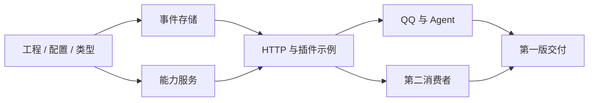

# 开发目标与实施计划

统一开发基线 0.3 · 2026-10-18。M0-01 已完成，验证范围见[工程基线](development.md)；其余任务待实现。阶段按依赖推进，不给未经估算的日历承诺。

## 1. 第一版目标

| 编号 | 目标 | 可见交付 |
| --- | --- | --- |
| G01 | 可运行、可扩展的宿主与内核 | 启动、配置、日志、事件持久化和明确错误 |
| G02 | 实际可用的插件开发入口 | 插件模板、模拟来源、变换和工具，能启停并清理资源 |
| G03 | 事件与能力双通道 | 独立 HTTP 客户端读写事件、发现工具、调用并查询结果 |
| G04 | QQ → Agent → 按需回复 | 指定范围真实入站，Agent 可回复或不回复，结果可解释 |
| G05 | 应用自主与组合 | 第二消费者独立位置，一方暂停不影响另一方 |
| G06 | 明确的普通故障行为 | 重启、重复身份、网络丢响应和 unknown 按契约处理 |

第一版完成要求 M0、M1、M2 的最小范围均交付。只完成宿主与模拟插件可以称“核心原型完成”，不能称“QQ 闭环完成”。

## 2. M0 · 宿主与双通道核心

| 任务 | 产物 | 退出检查 |
| --- | --- | --- |
| M0-01（已完成） | Node/TS ESM 工程、依赖锁、类型检查与测试脚本、数据忽略规则 | [锁定版本与 4 项风险探针](development.md)通过；不代表整个 T01 完成 |
| M0-02 | 基本配置校验、主体绑定、数据目录实例锁和启动关闭 | 错配拒绝；双实例拒绝；进程退出后锁释放；无秘密日志 |
| M0-03 | 领域类型、JSON/schema 校验和 HTTP DTO 转换 | bigint 与线上字符串无损；非法/超限输入被拒绝 |
| M0-04 | SQLite worker、初始 schema、事件追加/读取/lookup | T02/T03 通过；提交与通知结果独立 |
| M0-05 | 能力注册、授权、只读调用、calls 记录和查询 | 假提供者完成 T05/T06 的公共机制部分 |
| M0-06 | Cordis 服务适配、插件 API 与生命周期 | T01；模板可编译，实例和主体不由请求伪造 |
| M0-07 | HTTP /v1 与必要诊断 | HTTP 契约中已启用的接口与错误相符，无占位成功 |
| M0-08 | fixture、transform、mock 的实际示例，observer 最小读取版 | E1→E2、HTTP 读取及 mock.echo 完整可演示 |

退出：G01—G03 成立，T01—T03 和 T05/T06 公共部分通过；从干净开发环境可以按照说明启动示例。实际 SQLite 版本/PRAGMA、包锁和命令写入运行说明。

不要求这阶段完成真实账号、模型选择、附件、自动 GC 或备份平台。OneBot v11 协议核验与已有 Agent 接口确认可以同时进行。

## 3. M1 · QQ 与独立 Agent 回复闭环

| 任务 | 产物 | 退出检查 |
| --- | --- | --- |
| M1-01 | onebot-v11 正向通用 WS 插件与实现/版本/模式记录 | 标准握手、账号、身份、断线和重连在选定范围内验证 |
| M1-02 | 入站消息事件映射与来源授权 | 文本、账号/会话范围、自发回流和重复输入测试 |
| M1-03 | qq-main.reply 等实例化回复工具 | 目标来自可信输入事件；schema、权限和结果映射正确 |
| M1-04 | 现有 Agent 接入或独立参考进程 | 主动读取、有限上下文、reply/no_reply、稳定决定与 call_id |
| M1-05 | 真实演示与故障记录 | T04、T05/T06 平台部分及 T07；限制和未知状态可见 |
| M1-06 | 通用标准路径及必要兼容适配 | T09；夹具独立，选定实际服务通过，其他实现状态不冒充已验证 |

真实连接/发送前解决 Q01—Q03。先把适配代码、模拟用例和具体配置说明完成，取得相应实际范围后再连接；不因为缺少真实凭据就停止所有独立可做的工作。

退出：一条新入站消息触发 Agent 决策；不回复正常结束；需要回复则经受限能力发回同一会话；记录平台返回身份或 unknown；自己的回流不会无限触发。

来源不可验证的行为记录为不支持/未知；不要求先证明所有 QQ 消息、历史和材料完整。

## 4. M2 · 第二消费者与插件交付

| 任务 | 产物 | 退出检查 |
| --- | --- | --- |
| M2-01 | observer 的独立本地事件副本和检查点 | T08；范围内可查询，一方暂停不改变另一方位置 |
| M2-02 | 完整插件模板、三个以上可运行演示配置 | 添加新插件只改其代码/配置；生命周期清理可验证 |
| M2-03 | 启动、配置、诊断、正常关闭和数据目录说明 | 用户可从说明重现；运行命令均实际执行验证 |
| M2-04 | 版本与验收记录、限制、后续问题清单 | G01—G06 各有对应结果，不把后置能力写成已支持 |

M2 中的 observer 是有限事件副本样例，不把附件、全文搜索或多机备份偷偷加为第一版交付条件。

## 5. 依赖与可并行工作

HTTP 与插件开发围绕同一类型/服务契约推进。真实协议核验可以提前，账号接入和发送取决于用户范围。第二消费者可以在 M0 公共服务稳定后开始，不必等模型接入完成。

## 6. 每次变更的完成条件

代码与事件、能力、HTTP 和插件契约一致；类型检查和必要用例通过；错误结果可解释；没有真实秘密或用户数据入库；新增能力有实际配置与命令；版本与支持范围写清。

契约变化在同一次变更中更新文档。达到相关退出条件后推进后续任务，不为了凑测试数量扩大范围。可逆小修不要求机械添加测试，涉及事务、重试和外部写则必须有失败边界验证。

## 7. 第一版之后

根据使用反馈决定保留窗口与磁盘预算、SSE、材料保存、MCP 适配或更强隔离。没有这些实际需求时，继续改善插件接入和场景，不重新展开所有远期架构。

## 8. 实现选择与阶段门槛

M1 的真实服务可使用用户已有的 NapCat、SnowLuma 或其他满足选定 OneBot v11 子集的实现，不把任何品牌写成强制依赖。T09 要求协议通用性与一个实际服务的明确记录；第二个实际实现的测试可在其可用时补充，不用两份账号环境阻塞第一条真实闭环。正式兼容声明始终以各自记录为准。
