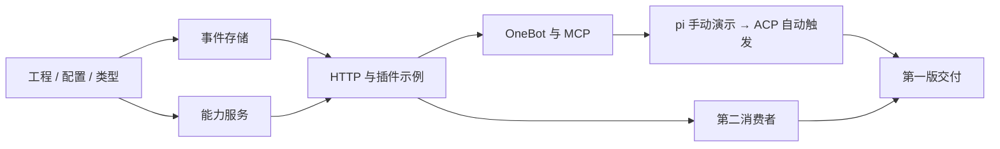

# 开发目标与实施计划

统一开发基线 0.3。M0-01—M0-08 已实现，范围与证据见[M0 运行验收](experiments/m0-runtime.md)；M1-01、M1-02 已实现并通过协议验证，其余 M1 与 M2 任务按下表推进。阶段按依赖推进，不给未经估算的日历承诺。

## 1. 第一版目标

| 编号 | 目标 | 可见交付 |
| --- | --- | --- |
| G01 | 可运行、可扩展的宿主与内核 | 启动、配置、日志、事件持久化和明确错误 |
| G02 | 实际可用的插件开发入口 | 插件模板、模拟来源、变换和工具，能启停并清理资源 |
| G03 | 事件与能力双通道 | M0 提供 HTTP；M1 增加 MCP，复用同一事件、授权和调用服务 |
| G04 | QQ → Agent → 按需回复 | 指定范围真实入站，Agent 可回复或不回复，结果可解释 |
| G05 | 应用自主与组合 | 第二消费者独立位置，一方暂停不影响另一方 |
| G06 | 明确的普通故障行为 | 重启、重复身份、网络丢响应和 unknown 按契约处理 |

第一版完成要求 M0、M1、M2 的最小范围均交付。只完成宿主与模拟插件可以称“核心原型完成”，不能称“QQ 闭环完成”。

## 2. M0 · 宿主与双通道核心

| 任务 | 产物 | 退出检查 |
| --- | --- | --- |
| M0-01（已完成） | Node/TS ESM 工程、依赖锁、类型检查与测试脚本、数据忽略规则 | [锁定版本与 4 项风险探针](development.md)通过；不代表整个 T01 完成 |
| M0-02（已实现） | 基本配置校验、主体绑定、数据目录实例锁和启动关闭 | 错配拒绝、实际宿主持锁、双实例拒绝、崩溃释放与重启通过 |
| M0-03（已实现） | 领域类型、JSON/schema 校验和 HTTP DTO 转换 | 大整数往返、Unicode 身份、非法/超限输入与 schema 边界通过 |
| M0-04（已实现） | SQLite worker、初始 schema、事件追加/读取/lookup | T02/T03 核心与 HTTP 链路通过；提交与通知结果独立 |
| M0-05（已实现） | 能力注册、授权、只读调用、calls 记录和查询 | T05/T06 公共机制及 HTTP 响应丢失路径通过 |
| M0-06（已实现） | Cordis 服务适配、插件 API 与生命周期 | 绑定、启停/重启、依赖卸载、清理失败与编译模板通过 |
| M0-07（已实现） | HTTP /v1 与必要诊断 | 鉴权、读写、工具/调用查询、诊断、限额和错误路径通过 |
| M0-08（已实现） | fixture、transform、mock 的实际示例，observer 最小读取版 | 两条原事件生成两条派生事件，独立位置与 mock.echo 可演示 |

退出：G01—G03 成立，T01—T03 和 T05/T06 公共部分通过；从干净开发环境可以按照说明启动示例。实际 SQLite 版本/PRAGMA、包锁和命令写入运行说明。

不要求这阶段完成真实账号、模型选择、附件、自动 GC 或备份平台。OneBot v11 协议核验与已有 Agent 接口确认可以同时进行。

## 3. M1 · OneBot、MCP 与 ACP 消费插件

2026-10-19 收敛的开发目标如下，各项状态与验证范围分别记录。Agent 首接复用 pi 与现成 pi-acp；模型循环、上下文和历史交给 Agent。协议职责见 [Agent 接入](agent-integration.md)，消费状态见[应用消费](applications.md)。

| 任务 | 模块与具体工作 | 必要验证 |
| --- | --- | --- |
| M1-01（已实现，协议模拟通过） | `src/plugins/onebot-v11/`：正向通用 WS、认证与账号核对、重连、入站映射、来源范围和 `<instance>.reply`；附小型 OneBot 模拟服务 | T04/T05/T06/T09：可信原事件决定回复目标，实际 Action 参数、重复输入、账号隔离、超限帧与发送未知结果；两组独立协议夹具 |
| M1-02（已实现，SDK 互通通过） | `src/adapters/mcp/`：在现有监听上挂载 `/v1/mcp` Streamable HTTP；按主体提供事件上下文、受限能力发现/调用和自己的调用查询 | T03/T05/T06 的 MCP 路径：发现与执行均鉴权，store_id/序号/call_id 不失真，结果不把 unknown 当成功 |
| M1-03（接入材料已准备，pi 发现通过；模型轮次待验证） | OneBot 模拟服务 + Imbrex + 人工驱动的 pi 演示；记录实际 pi/MCP 配置、版本和运行命令 | 真实 pi 能查到模拟输入、调用 reply，模拟服务收到正确 Action；不回复路径不发送；本项不需要真实 QQ 账号 |
| M1-04（实现中） | `src/plugins/acp-consumer/`：通过 stdio 启动配置的 ACP 程序，首接 pi-acp；读事件并筛选触发、关联平台会话与 ACP session、处理客户端请求、清理进程；保存最少消费状态 | T07：正常自动触发；发送 prompt 前持久保存 in_flight；未确认结束时暂停、不重放；会话不串用，停用/崩溃后资源按约定清理 |
| M1-05 | 一个真实 OneBot 服务的指定会话接入；将两阶段演示、实际支持范围与手工恢复步骤写入运行记录 | T04/T07/T09 真实部分；记录实现/版本/模式、成功与 unknown，不把模拟或其他实现的结果当作本服务证据 |

实施顺序为 M1-01 → M1-02 → M1-03 → M1-04 → M1-05。第一步在实现 onebot-v11 时一并修正 `src/host/modules.ts` 对所有 builtin 配置必须为空的限制：保留现有演示插件校验，让新插件用自己的结构化配置校验。无需先开一个脱离实际消费者的通用配置框架任务。

M1-01、M1-02 及 ACP 消费、恢复、生命周期的模拟验证可自动推进。M1-03 和 M1-04 的真实 Agent 联调需要可运行的 pi/pi-acp、模型配置与凭据；M1-05 还需要 Q02/Q03 的服务信息和发送范围。缺少这些信息时继续完成独立可做的代码、模拟验证和运行说明，真实互通保持待验证。

自动推进沿用分支/worktree → 实现与必要验证 → PR → 独立审核、修复并复审 → 最新提交 CI → 按已有授权合并的流程。每项分别记录已验证范围，不把计划调整当成功能已交付。

正常运行时，新入站消息由 Consumer 触发 Agent；Agent 可以不回复，也可经 MCP 调用受限能力回复同一会话。Consumer 只保存位置、会话关联和未决输入，不保存模型生成的 reply/no_reply 决定或另建发送队列。未决输入暂停并人工核验，核心 unknown 不自动补发；详见[恢复规则](applications.md)。

本阶段不新增 Runner、Agent 决策引擎、独立决策数据库或持久消息中间层。MCP stdio、远程 ACP 传输与通用调度由实际消费者需求触发。来源不可验证的行为记录为不支持/未知，不要求先证明全部 QQ 消息、历史和材料完整。

## 4. M2 · 第二消费者与插件交付

| 任务 | 产物 | 退出检查 |
| --- | --- | --- |
| M2-01 | observer 的独立本地事件副本和检查点 | T08；范围内可查询，一方暂停不改变另一方位置 |
| M2-02 | 完整插件模板、三个以上可运行演示配置 | 添加新插件只改其代码/配置；生命周期清理可验证 |
| M2-03 | 启动、配置、诊断、正常关闭和数据目录说明 | 用户可从说明重现；运行命令均实际执行验证 |
| M2-04 | 版本与验收记录、限制、后续问题清单 | G01—G06 各有对应结果，不把后置能力写成已支持 |

M2 中的 observer 是有限事件副本样例，不把附件、全文搜索或多机备份偷偷加为第一版交付条件。

## 5. 依赖与可并行工作

HTTP、MCP 与插件开发围绕同一类型/服务契约推进。真实协议核验可以提前，账号接入和发送取决于用户范围。第二消费者可以在 M0 公共服务稳定后开始，不必等模型接入完成。

## 6. 每次变更的完成条件

代码与事件、能力、HTTP 和插件契约一致；类型检查和必要用例通过；错误结果可解释；没有真实秘密或用户数据入库；新增能力有实际配置与命令；版本与支持范围写清。

契约变化在同一次变更中更新文档。达到相关退出条件后推进后续任务，不为了凑测试数量扩大范围。可逆小修不要求机械添加测试，涉及事务、重试和外部写则必须有失败边界验证。

## 7. 第一版之后

根据使用反馈决定保留窗口与磁盘预算、事件订阅 SSE、材料保存、MCP 的更多暴露方式、远程 ACP 或更强隔离。MCP Streamable HTTP 已列入 M1，其传输能力不代表网关新增了事件订阅保证。没有其他实际需求时，继续改善插件接入和场景。

## 8. 实现选择与阶段门槛

M1 的真实服务可使用用户已有的 NapCat、SnowLuma 或其他满足选定 OneBot v11 子集的实现，不把任何品牌写成强制依赖。T09 要求协议通用性与一个实际服务的明确记录；第二个实际实现的测试可在其可用时补充，不用两份账号环境阻塞第一条真实闭环。正式兼容声明始终以各自记录为准。
