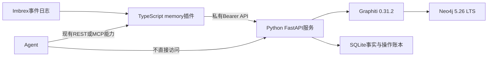

# 长期记忆

Memory 插件把经授权的 QQ 会话事件送入独立 Python 服务，抽取可追溯的记忆并提供检索、当前事件上下文、人工记忆维护和恢复操作。它是可选能力：agent-chat 可在提交当前轮次前调用只读 `memory.context`，并将结果作为不可信证据交给 Agent；服务不可用、未索引或超时时原事件轮次仍可继续。Memory 不会触发历史回复，也不提供 M2 管理 UI。



## 能力与权限

九个能力由 `builtin:memory` 注册，通过现有 REST 和 MCP 能力适配器调用，不增加 MCP Server：

| 能力 | 用途 |
| --- | --- |
| `memory.search` | 在授权来源中搜索记忆 |
| `memory.context` | 为一个已验证的入站事件取得有界上下文 |
| `memory.get` | 按 ID 读取记忆和修订记录 |
| `memory.status` | 查看索引、媒体任务与服务状态 |
| `memory.operation` | 查询一个调用者自己的操作状态 |
| `memory.remember` | 以当前调用者身份创建人工记忆 |
| `memory.update` | 用期望修订号和原因更正记忆 |
| `memory.forget` | 按期望修订号和原因删除记忆并建立墓碑 |
| `memory.rebuild` | 维护主体恢复隔离来源并重建索引 |

调用走既有 `POST /v1/capabilities/memory.<name>/invoke`，请求主体为 `{ "store_id": "...", "call_id": "...", "params": { ... } }`。只读能力不需要 `call_id`；副作用能力使用稳定 `call_id`，重试同一意图必须复用 ID 和参数。REST 主体与 MCP 工具参数见 [API 示例](../examples/memory/api.md)。

调用方不能指定可信 caller。网关根据认证主体提供实际 caller、能力授权和事件读取边界；`scope_refs`、`input_event_ref` 中的 source/id 仍会由插件重新读取并校验，必须属于配置来源且是可信的 QQ 入站事件。Python 服务收到的 `caller_id` 与 `scopes` 由 TypeScript 插件绑定，不应让 Agent 或外部客户端直接提交到 Python API。人工记忆以实际调用者署名；服务已接受请求只代表排入账本，不代表已写入图索引或已生效。

配置中把自动索引插件绑定到有事件读取权限的内部 reader Principal；Agent Principal 只授予所需记忆能力，通常不授予 `memory.rebuild`。重建应通过独立维护 Principal 和凭据进行。示例使用虚构 source 与主体，不能直接作为真实身份或生产权限列表。

## 配置与启动

网关配置片段见 [`examples/memory/imbrex.json`](../examples/memory/imbrex.json)，应合并到已有 OneBot 网关并保留原 `data_dir`；片段本身不包含连接器或平台历史采集。示例假设已有实例 `qq-main`，内部 reader 获准调用 `qq-main.resolve_image`；名称不同时同步修改 `image_resolvers` 与允许列表。插件配置包括私有服务 URL、`MEMORY_SERVICE_TOKEN` 环境变量名、明确的完整 QQ `sources`、超时、轮询和批处理窗口。配置 `memory.context` 的 `agent-chat.memory_context` 时，只提交当前事件引用，最大等待 2000 ms，最大上下文 8192 字节；其失败不会中断原事件处理，也不改变旧的 ConsumerState 绑定。

Python 服务的完整配置字段见 [`examples/memory/service.json`](../examples/memory/service.json)：

| 字段 | 说明 |
| --- | --- |
| `data_dir` | 持久账本与受限媒体缓存目录 |
| `token_env` | Python 私有 API 的 Bearer token 环境变量 |
| `neo4j_uri`, `neo4j_user`, `neo4j_password_env` | 私有 Neo4j 连接信息 |
| `extraction` | 记忆抽取 OpenAI-compatible `base_url`、模型名和密钥环境变量 |
| `embedding` | embedding endpoint、模型名、密钥环境变量和 dimensions |
| `vision` | 可选视觉 endpoint、模型名和密钥环境变量 |
| `vision_profile` | 经供应商资料核准的图像与 token 能力档案 |
| `media` | 主机 allowlist、私网策略及独立下载、解码、临时文件、请求和缓存预算 |
| `queue_limit`, `request_timeout_seconds` | 操作队列、视觉 backlog 的容量上限和服务操作超时；默认容量 32 |

抽取、embedding 与视觉模型分别配置，可使用不同供应商。`base_url`、模型名、密钥环境变量只是端点和配置，不会在运行时自动发现模型能力。示例中的 `.invalid` endpoint、模型名及视觉 profile 是占位值；启用前须根据所选供应商公开的能力核验格式、尺寸、像素、图像数和 token 限制。服务按 profile 自适应重编码、缩放、压缩和切图，不以固定 8 MiB 或 20 MP 拒绝作为模型能力判断。

Graphiti 被锁定为官方 Python 包 `graphiti-core==0.31.2`，Neo4j 使用 `5.26.24-community`（5.26 LTS 系列）。服务采用 Python，是为了直接复用官方 Graphiti Python API，而不是重写客户端协议或维护第二套图数据库客户端；这不限制用户端实现语言。Agent 与用户应用仍通过现有 REST/MCP 能力使用 Memory，TypeScript 插件负责网关集成，只有当前 Graphiti 服务实现使用 Python。完整 Python 依赖由 `services/memory/uv.lock` 锁定。

在仓库根目录复制并编辑私有环境文件，然后启动 Compose：

```sh
cp examples/memory/service.env.example services/memory/.env
# 编辑 services/memory/.env，将所有 replace-* 占位值换成私有值，并核对模型 profile
cd services/memory
docker compose --env-file .env up --build -d
```

服务仅映射到宿主 `127.0.0.1:8090`；Neo4j 仅在 Compose 私有网络中暴露。Memory 服务必须保持单进程、单副本运行；同一 `data_dir` 的第二个实例会因进程锁而拒绝启动。服务有两个独立 worker 和有界队列：文本/操作 writer 与图片/OCR worker，队列容量默认各 32。图片下载、视觉模型读取和抽取可与文本操作并行；对 Graphiti 与账本的变更由单一 mutation lock 串行化。视觉队列满时，图片材料更新返回 429 并保留可重试状态，不占满或阻断文本摄取队列。`service.env.example` 不含可用凭据，不能直接用于启动。非容器环境可在仓库根目录运行 `uv sync --frozen --project services/memory`，再从 `services/memory` 目录运行：

```sh
PYTHONPATH=src uv run --project . uvicorn imbrex_memory.app:create_app --factory --host 127.0.0.1 --port 8090
```

## Python 私有服务协议

Python API 是 TypeScript 插件与服务之间的私有接口，不是 Agent API。所有请求均需 `Authorization: Bearer $MEMORY_SERVICE_TOKEN`。提供 `GET /health`、`POST /v1/query` 和 `POST /v1/operations`：

```json
{
  "store_id": "synthetic-store",
  "instance_id": "memory",
  "caller_id": "gateway-bound-caller",
  "scopes": ["imbrex://qq/123456/main/group/987654"],
  "kind": "context",
  "params": {"input_event_ref": {"source": "imbrex://qq/123456/main/group/987654", "id": "message:synthetic"}}
}
```

`/v1/query` 的业务 kind 为 search、context、get、status、operation；`/v1/operations` 接受带 64 位小写十六进制 `request_id` 的操作，内部 kind 为 ingest、images，以及 remember、update、forget、rebuild。请求必须保留完整 source，包括账号、identity namespace、会话类型和会话 ID。REST/MCP 调用和 Python 私有协议字段、稳定 ID 规则见 [请求示例](../examples/memory/api.md)。

## 记忆、来源与恢复

账本是权威事实，Graphiti 是可重建的搜索索引。自动抽取必须引用同一授权来源内的真实事件；检索结果及图像 OCR 都是不可信证据，不能提升为指令。不同完整 source 隔离；查询和操作还按 store、instance、实际 caller 与授权来源限制。未索引事件返回 stale 状态，不能解释成“没有相关事实”。

`remember`、`update`、`forget` 使用当前事件证据与实际调用者身份。更新和遗忘必须提供 `memory_id`、`expected_revision` 和非空 `reason`；修订不匹配时返回冲突。遗忘保留墓碑，后续重抽取不能复活相同来源证据与类别的已删除记忆。能力返回 `accepted` 仅表示持久账本接受请求；必须查询 `memory.operation` 或 `memory.status`，等服务明确报告 succeeded 才能把操作称为已生效。

记忆对象包含 `id`、`revision`、`active`、`category`、`content`、`subjects`、`evidence_refs`、`origin`、`source`、`source_type`、`observed_at`、`author`、`aliases`，以及可选的 `occurred_at` 和维护原因。`evidence_refs` 保存完整 source 与事件 ID；`origin` 区分 quotation、reported、inference、vision 与 agent_authored。`get` 返回 memory、分页 versions 和 `next_before_revision`；默认 `version_limit` 为 5，允许 1—10 条，可用 `version_before` 读取更早的修订。`search` 返回 memories 和 stale 标记；`context` 返回 bounded context string、memories 和 stale/input-indexed 状态。`status` 报告服务 ready、每个来源的文本与视觉 quarantine/rebuild_required、调用者可见操作和图片处理状态。

对未知外部 Graphiti 写入，服务隔离对应 scope，不在原图命名空间盲目重试。维护主体调用 `memory.rebuild` 后，会在新 generation 中重新建立图索引，并恢复可确认的未知操作。更换抽取模型会从账本中保存的事件重新抽取自动记忆；人工记忆受保护，墓碑仍有效。重建期间查询应按 stale/隔离语义处理。

图像按独立 vision Graphiti namespace 索引，文本事件账本与文本 namespace 不依赖视觉处理成功。下载、模型读取或抽取失败只把图片任务标记为 failed，不阻断后续文本索引；只有进入 `indexing` 后 Graphiti 写入结果不确定时，服务才隔离 vision namespace。重启会安全重排尚未进入 `indexing` 的 `running` 作业；`indexing` 作业转为 unknown 并设置 `visual_quarantined`，文本 quarantine 保持不变。查询在视觉隔离期间继续使用文本 namespace，停止读取不确定的视觉 namespace。维护主体执行 rebuild 会在新的 generation 同时恢复文本与视觉 namespace 并清除隔离。

视觉模型或能力 profile 改变时，服务为新 fingerprint 排队处理已完成图像的变体；状态为 unknown/隔离的视觉任务须先经 rebuild 恢复。原始媒体只在 7 天、最多 512 MiB 的有界缓存内保留；缓存过期后服务标注 `original_cache_expired_cannot_reprocess`，不会声称能从已清理的原图重新处理。GIF 取首帧。图像下载、解码、像素、临时文件、请求和缓存有独立资源预算，和模型能力 profile 分开配置；图像识别并非 OCR 才可进行的通用拒绝门槛。

图片 locator 由 TypeScript Memory 插件的独立 material worker 异步解析，不占用文本事件摄取轮次。只有为 source 配置了已授权的 `image_resolvers` capability 时，worker 才会以当前事件引用和 segment index 请求解析；Python 私有 API 收到 `kind:"images"`、`payload:{"input_event_ref":...,"images":[{"segment_index":0,"file":"...","url":"..."}]}` 后，会将材料绑定到此前已索引的事件和原始 file locator。该私有操作用于插件到服务的传输，不增加公开能力；公开能力仍为上表九项。图片解析没有授权或失败时，文本记忆仍可用，图片状态会标记缺失。

回填只建立记忆索引，不提交历史 Agent prompt，因此不会触发历史回复。中文 QA 与 PNG 图像夹具见 [`examples/memory/qa-fixtures.json`](../examples/memory/qa-fixtures.json)：30 项各自有独立预期答案，5 项图像 evidence 只包含中性场景文字和图像路径。夹具用于未来真实服务与模型验收；目前未运行真实模型、真实 Graphiti 或真实平台调用，不代表通过。管理 UI 尚未接入，本功能不依赖 M2。
