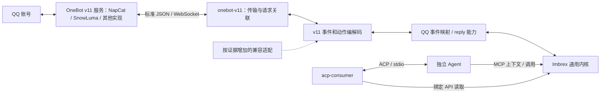

# OneBot v11 与 Agent 接入

当前状态：M1-01 已实现标准子集与模拟验证；可以加载 builtin:onebot-v11。真实 OneBot 服务、MCP 和 ACP 链路仍按各自任务验收，参见[运行记录](experiments/m1-onebot.md)。

统一开发基线 0.3 · 2026-10-18。本文定义协议连接器及首个 QQ 闭环。**插件名为 onebot-v11；NapCat、SnowLuma 等是它可以对接的服务实现。** 标准与实现的依据见[参考资料](references.md#r7)。

## 1. 协议、实现、传输与业务分别看待

| 层次 | 本版对象 | 职责 |
| --- | --- | --- |
| 协议 | OneBot v11 | 定义动作、事件、响应及通信约定 |
| 远端实现 | NapCat、SnowLuma 或其他满足选定子集的服务 | 连接 QQ 客户端/账号，并提供 OneBot 接口 |
| 传输 | 首版正向通用 WebSocket | Imbrex 作为客户端，一条连接收事件和调动作 |
| Imbrex 插件 | builtin:onebot-v11 | 协议编解码、连接管理、QQ 事件映射与能力封装 |
| 通用内核 | events/capabilities | 存储、读取、授权及调用记录，不认识具体 QQ 实现 |
| 输入消费 | acp-consumer 插件 | 筛选入站触发、通过 ACP 提交给 Agent、保存最少进度与未决状态 |
| Agent | 现成 pi/pi-acp | 分析与上下文管理，通过 MCP 查询网关并按需调用能力 |

不调用 NapCat/SnowLuma 的私有 SDK，不访问其数据库或把它们的运行时嵌入 Imbrex。其他来源插件也不需要先伪装成 OneBot。

OneBot v11 与 v12 不混在一个模糊的“兼容 OneBot”承诺里。本版只实现 v11 的明确子集；v12 是独立后续适配。

## 2. 连接器内部结构



这些是同一插件内的职责分工，不要求三个插件或多个进程。默认 generic 路径只使用标准动作/事件；有实际差异才增加小的兼容适配，不能复制两套完整的 NapCat/SnowLuma 连接器。

## 3. 首版标准子集

- 通过配置的完整 ws_url 连接服务提供的通用 API+Event 地址，不写死实现专属端口或路径。
- 需要 access token 时通过 Authorization: Bearer 请求头发送；不把 Agent 的 Imbrex token 转发给远端服务。
- 读取 get_version_info、get_login_info，必要时读取 get_status；记录声明的实现名、版本和协议版本。
- 接收所允许账号的 message 事件，处理 group/private 文本及必要的 reply/text 消息段。
- 使用 send_group_msg / send_private_msg 执行受限回复；协议已有的只读信息调用用于初始化与核验。
- API 请求使用独立 echo 关联响应；echo 不是平台幂等键。

正向 WS 的 `/`、`/api`、`/event` 及反向 WS 是协议中的不同连接方式；首版配置必须指向通用连接，暂不实现拆分连接、反向 WS 或 HTTP 上报。将来确有服务只提供这些模式时，增加传输适配，不改变事件/能力内核。[R7](references.md#r7)

响应声明的协议版本明确不符合 v11 时拒绝启用。字段缺失记为未知，通过所选配置及兼容测试决定可用范围，不能靠猜产品名认定全兼容。登录账号与配置不一致时不接纳该连接的业务输入，也不开放回复。

## 4. 配置与权限

下面是补入[基础配置](operations.md)的 QQ 连接器与主体条目，示例默认禁用，ID 和端口均为占位测试值：

```json
{
  "principals": [
    {
      "id": "qq-connector",
      "permissions": ["events:write"],
      "read_sources": [],
      "write_sources": [{"prefix": "imbrex://qq/123456/main/"}],
      "invoke_capabilities": []
    },
    {
      "id": "qq-agent",
      "token_env": "IMBREX_QQ_AGENT_TOKEN",
      "permissions": ["events:read", "capabilities:list", "capabilities:invoke", "calls:read"],
      "read_sources": [{"prefix": "imbrex://qq/123456/main/"}],
      "write_sources": [],
      "invoke_capabilities": ["qq-main.reply"]
    }
  ],
  "plugins": [
    {
      "id": "qq-main",
      "module": "builtin:onebot-v11",
      "principal_id": "qq-connector",
      "required": false,
      "enabled": false,
      "config": {
        "transport": "ws-forward",
        "ws_url": "ws://127.0.0.1:6700/",
        "access_token_env": "IMBREX_ONEBOT_TOKEN",
        "account_id": "123456",
        "identity_namespace": "main",
        "compatibility_profile": "generic",
        "allow_private_ids": ["654321"],
        "allow_group_ids": ["987654"]
      }
    }
  ]
}
```

只合并这两组条目，不用此片段覆盖完整配置。真实使用时填写实际值、确认服务认证与会话范围，再启用插件和全局外部写开关。access_token_env 未配置仅用于明确无认证的受控服务；已配置但环境变量缺失则启动失败。

首版必须有 generic 配置；不预先承诺 napcat/snowluma 等命名 profile 已实现。只有确有差异且有测试时才加入相应 profile，未知 profile 拒绝启动。

当前实现拒绝 ws_url 中的用户名、密码、query 与 fragment；认证只从 access_token_env 读取。账号、群号、用户号配置为无前导零的正十进制字符串，最大 Number.MAX_SAFE_INTEGER；消息 ID 接受 int32 范围（包括负数）。Action 的 group_id/user_id 编码为精确整数，reply.id 为字符串。白名单各至多 1024 项，消息至多 128 段；只接受 text/reply 数组段或对应 CQ 字符串，其他段拒收。群聊只接收 sub_type=normal，自身群消息保存为 outbound；不声明完整自发消息覆盖。

握手和单次 Action 等待上限为 5 秒；断线后间隔 1 秒重连，15 秒发送一次 WS ping、下个周期仍无 pong 则关闭。每个连接最多 8 个未决请求、64 KiB 帧和 32 条待写事件；溢出关闭连接并报告诊断，未持久化输入可能丢失。没有历史补取或自动重发。绑定文件 onebot-binding.json 通过文件 fsync、rename、目录 fsync 保存；观察到实现名称变化时拒绝恢复，版本升级保留记录但不等于兼容声明。

## 5. 身份不绑定实现品牌，也不假定跨实现天然连续

source 采用 `imbrex://qq/<account_id>/<identity_namespace>/<group|private>/<conversation_id>`。段值按 URI 规则编码。实现品牌不进入 source/type/能力名称。

identity_namespace 是该账号一段经过验证的原生事件身份范围，格式遵循 HTTP 契约中的命名空间 ID 规则，由配置显式指定并在普通重连/重启后保持；它不是每次运行随机生成的连接 ID。插件的本地绑定记录保存 account_id、identity_namespace 及已观察的实现信息，避免无意把旧状态套给新来源。

事件 id 基于此范围内稳定的原生 message_id 与发生类型生成，原消息 ID 另存 native_message_id。创建、编辑、撤回是不同事件发生；第一版只声明已验证的文本创建事件支持。数字 ID 在接入边界检查可表示性后转字符串，不能先舍入再转。

**相同 OneBot 字段不证明不同实现生成的是同一套消息 ID。** 更换实现、账号或实现内部消息库重建时，默认建立新 identity_namespace 和新插件实例；旧输入与调用记录仍保留。只有验证过原生身份和动作语义连续，才允许显式复用。

普通同一服务重连不改变命名空间。无法检测到的底层重置仍需操作者说明，插件不宣称自动识别所有历史变化。

## 6. 事件映射与来源覆盖

事件 type 为 qq.message.group / qq.message.private；data 至少包含 account_id、identity_namespace、conversation_type、conversation_id、sender_id、native_message_id、direction、text 及受控 message_segments。

只接纳配置账号与允许范围内的事件。self_id/登录账号冲突时报告身份错误；自身消息标 outbound，不伪装成新的入站触发。只有指定连接器主体能发布这个 source 范围，Agent 派生事件使用自己的来源。

入站先校验大小、结构、身份，再通过内核 append。原始 WS 帧和待办队列有界；过大内容、队列失败、磁盘失败及断线都进入诊断，不能以无界缓存宣称不丢。

连接恢复不等于缺口补齐。历史补取、撤回/编辑、自发消息覆盖、附件与实现扩展分别记录支持范围；协议字段存在或官方功能列表不等于本项目已验收。

## 7. 回复能力

localName=reply，完整 ID 由实例得到，例如 qq-main.reply；schema_version=1，is_side_effectful=true。统一输入：

```json
{
  "type": "object",
  "properties": {
    "input_event_ref": {
      "type": "object",
      "properties": {
        "source": {"type": "string", "minLength": 1},
        "id": {"type": "string", "minLength": 1}
      },
      "required": ["source", "id"],
      "additionalProperties": false
    },
    "text": {"type": "string", "minLength": 1, "maxLength": 2000}
  },
  "required": ["input_event_ref", "text"],
  "additionalProperties": false
}
```

handler 通过 invocation.readEvent 按实际 caller 权限读原事件，核验可信来源、账号、当前 identity_namespace、允许会话及入站方向。目标与被回复 ID 从原事件取得，不由模型单独指定。旧命名空间引用返回明确 failed 原因，不把旧实现的 native_message_id 发给新实现。

发送使用显式 text 段及已验证的 reply 引用段，不把模型文字当 CQ 控制字符串。原生字段按所选 v11 子集编码；如果实现需要不同的合法数值/字符串表示，在有测试的兼容适配中转换，不进行精度丢失的强制转换。

status=ok、retcode 与合法的 message_id 等确定结果共同核验后，才能报告 succeeded。异步接纳或没有最终结果的响应不等于发送成功；已派发后的断线、超时或不可判定失败保持 unknown，不自动重发。明确的未执行拒绝才归为 failed。

每次底层请求使用新的 echo，与 Imbrex call_id 分开；旧连接的迟到响应不能完成另一条调用。网关调用表保持重试语义，不能把它委托给某个实现恰好提供的私有参数。

成功 result 返回 native message_id 的字符串表示及必要账号/会话信息；它不表示对方已读。

`qq-main` 是配置实例的例子，能力通用形式为 `<instance>.reply`，MCP 不硬编码 QQ 或具体 OneBot 实现。当前插件选定的 v11 事件类型、账号与消息段仍有 QQ 语义；这不构成跨平台兼容承诺。

## 8. Agent 与第二消费者

M1 首接复用 pi 与现成 pi-acp。acp-consumer 通过绑定 API 读取并筛选输入，再经 ACP stdio 提交；Agent 通过同一个 MCP adapter 查询上下文与调用 reply，模型循环和历史由 Agent 管理。具体协议分工见 [Agent 接入](agent-integration.md)。

Consumer 保存输入位置、会话关联和 prompt 提交前的 in_flight；中断未确认时暂停，不重跑整轮 Agent。正常 end_turn 不证明平台回复成功，动作结果仍按 calls 查询。不再建设参考 Agent 决策库或独立发送循环，恢复流程见[应用消费](applications.md)。

输入来自哪个 OneBot 实现不改变 Agent 的工具 schema、调用协议或内核访问方式。历史上下文、自发回流和诊断事件不成为新回复触发；旧消息策略在真实试用前明确。

第二消费者独立保存自己的进度，验证暂停/恢复和有限事件查询，不与 Agent 共享确认。

## 9. 兼容性怎样记录

| 对象 | 当前证据 | 运行兼容状态 |
| --- | --- | --- |
| OneBot v11 标准子集 | 官方通信、认证、动作文档已核对；两组独立字段表示夹具 | 已通过本地协议测试，真实服务待验证 |
| NapCat | [官方固定源码](references.md#r6)可定位 v11 发送路径 | 未在本项目实际连接验证 |
| SnowLuma | [官方说明](references.md#r11)提供 v11 动作/事件及 WS 服务端/客户端 | 未在本项目实际连接验证 |
| 其他实现 | 依据其标准符合性和选定模式 | 未验证，不自动列为支持 |

同一插件的协议测试至少使用两组独立的标准实现夹具，检查不同实现名、账号/版本信息和可接受表示。M1 用一个用户现有服务完成真实闭环；第二个实现可用时按同一用例顺序切换验证，不要求同时登录同一账号。未做第二个真实验证就不宣称它已经运行兼容。

更成熟、更可靠等比较需要同范围运行证据，本基线不作排名。记录实际实现版本、账号模式、传输、profile、身份命名空间和通过/未支持项，比仅列品牌更有用。
