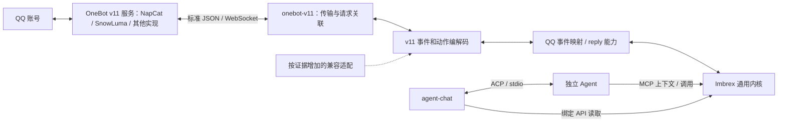

# onebot-v11 · OneBot v11 连接器

`onebot-v11` 把 OneBot v11 服务接入内核：连接、身份映射、QQ 事件映射与受控读取/通信/管理能力。它是参考闭环的一部分，不是网关的必要组成——删掉它，其他来源可由自己的插件直接接入内核。

- 模块：`src/plugins/onebot-v11/`
- 插件 ABI：[插件开发契约](../../../docs/design/plugins.md)
- 事件与能力契约：[HTTP 契约](../../../docs/design/contracts.md)、[能力调用](../../../docs/design/capabilities.md)
- 配置与运维：[配置与运维](../../../docs/ops/operations.md)

---

## 1. 连接器内部结构



这些是同一插件内的职责分工，不要求三个插件或多个进程。generic 路径使用标准动作/事件及有界历史读取扩展；服务不提供扩展时明确返回 feature_unavailable。有实际差异才增加小的兼容适配，不能复制两套完整的 NapCat/SnowLuma 连接器。

不调用 NapCat/SnowLuma 的私有 SDK，不访问其数据库或把它们的运行时嵌入 Imbrex。其他来源插件也不需要先伪装成 OneBot。OneBot v11 与 v12 不混在一个模糊的"兼容 OneBot"承诺里；v12 是独立后续适配。

## 2. 首版标准子集

- 通过配置的完整 ws_url 连接服务提供的通用 API+Event 地址，不写死实现专属端口或路径。
- 需要 access token 时通过 `Authorization: Bearer` 请求头发送；不把 Agent 的 Imbrex token 转发给远端服务。
- 读取 get_version_info、get_login_info，必要时读取 get_status；记录声明的实现名、版本和协议版本。
- 接收所允许账号的 group/private message 和 friend/group request。消息保留 text、reply、at、image、forward、face 的有界元数据，其他段保留 unsupported 类型摘要，不因未知段拒绝周围文本，也不将其变成出站参数。
- 使用 send_group_msg / send_private_msg 执行受限回复和结构化发送，并提供下表的只读上下文与受控管理能力。
- API 请求使用独立 echo 关联响应；echo 不是平台幂等键。

正向 WS 的 `/`、`/api`、`/event` 及反向 WS 是协议中的不同连接方式；首版配置必须指向通用连接，暂不实现拆分连接、反向 WS 或 HTTP 上报。将来确有服务只提供这些模式时，增加传输适配，不改变事件/能力内核。

响应声明的协议版本明确不符合 v11 时拒绝启用。字段缺失记为未知，通过所选配置及兼容测试决定可用范围，不能靠猜产品名认定全兼容。登录账号与配置不一致时不接纳该连接的业务输入，也不开放回复。

## 3. 配置与权限

下面是补入[基础配置](../../../docs/ops/operations.md)的连接器与主体条目，示例默认禁用，ID 和端口均为占位测试值：

```json
{
  "principals": [
    {
      "id": "qq-connector",
      "permissions": ["events:write"],
      "read_sources": [],
      "write_sources": [{"prefix": "imbrex://qq/123456/main/"}],
      "invoke_capabilities": []
    },
    {
      "id": "qq-agent",
      "token_env": "IMBREX_QQ_AGENT_TOKEN",
      "permissions": ["events:read", "capabilities:list", "capabilities:invoke", "calls:read"],
      "read_sources": [{"prefix": "imbrex://qq/123456/main/"}],
      "write_sources": [],
      "invoke_capabilities": ["qq-main.reply"]
    }
  ],
  "plugins": [
    {
      "id": "qq-main",
      "module": "builtin:onebot-v11",
      "principal_id": "qq-connector",
      "required": false,
      "enabled": false,
      "config": {
        "transport": "ws-forward",
        "ws_url": "ws://127.0.0.1:6700/",
        "access_token_env": "IMBREX_ONEBOT_TOKEN",
        "account_id": "123456",
        "identity_namespace": "main",
        "compatibility_profile": "generic",
        "allow_private_ids": ["654321"],
        "allow_group_ids": ["987654"]
      }
    }
  ]
}
```

只合并这两组条目，不用此片段覆盖完整配置。真实使用时填写实际值、确认服务认证与会话范围，再启用插件和全局外部写开关。access_token_env 未配置仅用于明确无认证的受控服务；已配置但环境变量缺失则启动失败。

首版必须有 generic 配置；不预先承诺 napcat/snowluma 等命名 profile 已实现。只有确有差异且有测试时才加入相应 profile，未知 profile 拒绝启动。

当前实现拒绝 ws_url 中的用户名、密码、query 与 fragment；认证只从 access_token_env 读取。账号、群号、用户号配置为无前导零的正十进制字符串，最大 `Number.MAX_SAFE_INTEGER`；消息 ID 接受 int32 范围（包括负数）。Action 的 group_id/user_id 编码为精确整数，reply.id 为字符串。白名单各至多 1024 项，消息至多 128 段；只接受 text/reply 数组段或对应 CQ 字符串，其他段拒收。群聊只接收 `sub_type=normal`，自身群消息保存为 outbound；不声明完整自发消息覆盖。

握手和单次 Action 等待上限为 5 秒；断线后间隔 1 秒重连，15 秒发送一次 WS ping、下个周期仍无 pong 则关闭。每个连接最多 8 个未决请求、512 KiB 帧和 32 条待写事件，规范事件仍有 64 KiB 上限；溢出关连接并报告诊断，未持久化输入可能丢失。没有自动补取历史或自动重发。绑定文件 onebot-binding.json 通过文件 fsync、rename、目录 fsync 保存；观察到实现名称变化时拒绝恢复，版本升级保留记录但不等于兼容声明。

## 4. 身份不绑定实现品牌，也不假定跨实现天然连续

source 采用 `imbrex://qq/<account_id>/<identity_namespace>/<group|private>/<conversation_id>`。段值按 URI 规则编码。实现品牌不进入 source/type/能力名称。

identity_namespace 是该账号一段经过验证的原生事件身份范围，格式遵循 [HTTP 契约](../../../docs/design/contracts.md)中的命名空间 ID 规则，由配置显式指定并在普通重连/重启后保持；它不是每次运行随机生成的连接 ID。插件的本地绑定记录保存 account_id、identity_namespace 及已观察的实现信息，避免无意把旧状态套给新来源。

事件 id 基于此范围内稳定的原生 message_id 与发生类型生成，原消息 ID 另存 native_message_id。创建、编辑、撤回是不同事件发生；第一版只声明已验证的文本创建事件支持。数字 ID 在接入边界检查可表示性后转字符串，不能先舍入再转。

**相同 OneBot 字段不证明不同实现生成的是同一套消息 ID。** 更换实现、账号或实现内部消息库重建时，默认建立新 identity_namespace 和新插件实例；旧输入与调用记录仍保留。只有验证过原生身份和动作语义连续，才允许显式复用。

普通同一服务重连不改变命名空间。无法检测到的底层重置仍需操作者说明，插件不宣称自动识别所有历史变化。

## 5. 事件映射与来源覆盖

事件 type 为 `qq.message.group` / `qq.message.private`；data 至少包含 account_id、identity_namespace、conversation_type、conversation_id、sender_id、native_message_id、direction、text 及受控 message_segments。

只接纳配置账号与允许范围内的事件。self_id/登录账号冲突时报告身份错误；自身消息标 outbound，不伪装成新的入站触发。只有指定连接器主体能发布这个 source 范围，Agent 派生事件使用自己的来源。

入站先校验大小、结构、身份，再通过内核 append。原始 WS 帧和待办队列有界；过大内容、队列失败、磁盘失败及断线都进入诊断，不能以无界缓存宣称不丢。

连接恢复不等于缺口补齐。历史补取、撤回/编辑、自发消息覆盖、附件与实现扩展分别记录支持范围；协议字段存在或官方功能列表不等于本项目已验收。

## 6. 回复能力

localName=reply，完整 ID 由实例得到，例如 `qq-main.reply`；schema_version=1，is_side_effectful=true。统一输入：

```json
{
  "type": "object",
  "properties": {
    "input_event_ref": {
      "type": "object",
      "properties": {
        "source": {"type": "string", "minLength": 1},
        "id": {"type": "string", "minLength": 1}
      },
      "required": ["source", "id"],
      "additionalProperties": false
    },
    "text": {"type": "string", "minLength": 1, "maxLength": 2000}
  },
  "required": ["input_event_ref", "text"],
  "additionalProperties": false
}
```

handler 通过 invocation.readEvent 按实际 caller 权限读原事件，核验可信来源、账号、当前 identity_namespace、允许会话及入站方向。目标与被回复 ID 从原事件取得，不由模型单独指定。旧命名空间引用返回明确 failed 原因，不把旧实现的 native_message_id 发给新实现。

发送使用显式 text 段及已验证的 reply 引用段，不把模型文字当 CQ 控制字符串。原生字段按所选 v11 子集编码；如果实现需要不同的合法数值/字符串表示，在有测试的兼容适配中转换，不进行精度丢失的强制转换。

status=ok、retcode 与合法的 message_id 等确定结果共同核验后，才能报告 succeeded。异步接纳或没有最终结果的响应不等于发送成功；已派发后的断线、超时或不可判定失败保持 unknown，不自动重发。明确的未执行拒绝才归为 failed。

每次底层请求使用新的 echo，与 Imbrex call_id 分开；旧连接的迟到响应不能完成另一条调用。网关调用表保持重试语义，不能把它委托给某个实现恰好提供的私有参数。

成功 result 返回 native message_id 的字符串表示及必要账号/会话信息；它不表示对方已读。

`qq-main` 是配置实例的例子，能力通用形式为 `<instance>.reply`，MCP 不硬编码 QQ 或具体 OneBot 实现。当前插件选定的 v11 事件类型、账号与消息段仍有 QQ 语义；这不构成跨平台兼容承诺。

### 6.1 QQ 能力集合

完整 ID 为 `<instance>.<local_name>`。共 13 项只读、9 项外部写（含原 reply）。业务输入均为严格对象；网络调用另含 store_id/params，外部写另要求稳定 call_id。注册不自动扩大 Principal 的 invoke_capabilities；部署者逐项授权。

| local_name | 业务输入 | 性质 / Action |
| --- | --- | --- |
| get_login_info | {} | 只读；get_login_info，核验账号 |
| get_connection_status | {} | 只读；已核验连接及实际指标 |
| list_groups | limit?、offset? | 只读；get_group_list |
| get_group_info | group_id | 只读；get_group_info |
| list_group_members | group_id、limit?、offset? | 只读；get_group_member_list |
| get_group_member_info | group_id、user_id | 只读；get_group_member_info |
| list_friends | limit?、offset? | 只读；get_friend_list |
| get_user_info | user_id、context? | 只读；授权私聊 get_stranger_info；群上下文 get_group_member_info |
| get_message | target、message_id、input_event_ref? | 只读；get_msg，返回目标复核 |
| get_reply_context | input_event_ref | 只读；可信原消息的 reply 段决定 get_msg ID |
| get_forward_message | input_event_ref、segment_index | 只读；可信原消息的 forward 段决定 get_forward_msg ID |
| get_group_history | group_id、count? | 只读；get_group_msg_history 扩展 |
| get_private_history | user_id、count? | 只读；get_friend_msg_history 扩展 |
| reply | input_event_ref、text | 外部写；原 v1 契约保留 |
| send_message | target、segments | 外部写；send_group_msg / send_private_msg |
| revoke_message | target、message_id | 外部写；delete_msg，只撤回有本实例证明的消息 |
| set_member_mute | group_id、user_id、duration_seconds | 外部写；set_group_ban，0 为解禁 |
| kick_member | group_id、user_id、reject_add_request? | 外部写；set_group_kick，默认 false |
| set_member_card | group_id、user_id、card | 外部写；set_group_card，空串清除 |
| set_group_name | group_id、name | 外部写；set_group_name |
| handle_friend_request | input_event_ref、approve | 外部写；set_friend_add_request |
| handle_group_request | input_event_ref、approve、reason? | 外部写；set_group_add_request |

target/context 为 {type:"group"或"private",id:"十进制 ID"}，input_event_ref 为 {source,id}。引用必须属于当前账号/namespace 的可信原事件，不能用任意可读派生事件或裸 flag/forward_id 当凭证。目标授权是 caller 的 events:read/read_sources、具体能力授权、连接器生效名单的交集；写动作另受外部写开关及平台角色约束。群管理核验机器人角色，禁言/踢人只对普通成员；修改自身群名片不要求机器人管理员身份。

列表页 limit 默认 20、范围 1—50；offset 默认 0、最大 1000000。先过滤授权对象，再按 ID 字典顺序分页，结果 {items,total,has_more,next_offset} 的 total 仅为可见数量，next_offset 按实际返回项计算。每页重新查询，没有快照一致性承诺；未知可选字段返回 null。大项导致页缩短时仍保持正确续页；单项无法容纳时拒绝。

get_message 核验消息 ID/会话；缺少远端群目标字段或无法证明自身私聊发言的 peer 时，只接受匹配原事件/发送证明。get_reply_context 使用可信原消息的唯一 reply 段。历史 count 默认 20、最大 50，结果 {items,has_more:false,truncated,truncation_reason?}；输出按字节/数量有界，不追加旧内容为新事件，不承诺无限续页或完整补缺。

转发整树最多 3 层、50 节点、50 次远端查询，结果 {nodes,has_more:false,truncated,truncation_reason?}。节点含 sender_id、nickname、time、segments 和可选 nodes 子树；截断原因 node_limit/depth_limit/byte_limit。truncated=false 只在返回完整时成立；has_more=false 只说明没有续页工具。

成功 reply/send_message 的 ID 与 source 构成本实例发送证明，最多最近 1000 条；相同号出现不同来源或其他发送者的原消息时使旧证明失效。revoke_message 还在派发前查询当前平台消息，核验仍是本账号、同群 group_id 或同私聊 target_id，重新检查名单；平台缺少明确目标字段时拒绝。缓存/原事件只能补足读取时的缺失信息，不能覆盖返回的 group_id/target_id 冲突。歧义号、未确认发送、淘汰或插件重启后无证明时拒绝。撤回是新 call，不修改原发送记录。

### 6.2 结构化消息、请求与边界

自发私聊事实以已核验的 target_id 定位对端，sender_id 仍为机器人账号，direction 为 outbound，不当作回复触发。缺少对端字段时不以发送者账号猜会话；读取消息时明确 target_id/group_id 冲突优先拒绝，旧引用不能覆盖它们。

SnowLuma 的已核查公开撤回路径按有限消息哈希读取可覆盖的独立元数据；get_msg 的正文预检不是原子目标校验。声明为 SnowLuma 的连接在公开原子归属校验获得验证前禁用 revoke_message，缺少实现名时也不猜测支持：资格只取本次已核验握手的信息，重连不继承历史绑定中的实现名；历史绑定供诊断和一致性检查。核心登记供管理员 inspect 诊断，但 REST/MCP 普通能力发现不列为可用，直接新调用派发前返回 provider_unavailable。get_connection_status 与面板 capability_limits.revoke_message 提供 available=false 和 onebot_revoke_unsafe_message_identity 原因。其余 21 项能力与原调用查询保持；该限制不通过忽略冲突或私有 SDK 绕过。

send_message.segments 最多 32 段，只接受：

- text：{type:"text",data:{text}}，每段 1—2000 Unicode 字符，按字面发送，不执行 CQ。
- at：{type:"at",data:{qq}}，仅群，成员须能在目标群核验；all 另核验机器人管理员角色，配额由平台决定。
- reply：{type:"reply",data:{message_id,input_event_ref?}}；没有原事件引用时须命中同目标发送证明。
- image：{type:"image",data:{url}} 或 {type:"image",data:{input_event_ref,segment_index}}。URL 最多 2048 UTF-8 字节，HTTP/HTTPS 且无嵌入凭据，由 OneBot 下载；网关不下载，不宣称 DNS/重定向后的公网限制。引用图片复用当前账号/namespace 的可读消息中记录的 URL 或不带目录的原生标识；不接受调用者本机路径、file URL、base64。

项目保守输入预算：名片 60 UTF-8 字节、群名 30 Unicode 字符、禁言 0—2592000 秒；不声称所有实现共同保证这些上限。超限拒绝，不截断意图。

完整 WS 消息（含分片累积）与 Action JSON 解码为 512 KiB，结构深度为 32；单条入站事件与规范工具结果仍各为 64 KiB。超传输预算关闭连接，已派发写请求按真实结果保留 unknown；重连不补发。512 KiB 不按固定群人数保证容量。整表读取先接收有界响应再过滤分页，不建无界缓存。

请求沿用所属 private/group 会话 source，不增加 /request，保留 exact 来源授权。type 为 qq.request.friend/qq.request.group；id 为 request:<kind>:<conversation>:<完整 SHA-256>，摘要绑定账号、namespace、种类、目标、用户、sub_type、原 flag。重放使用稳定身份；不声称摘要数学上绝对无碰撞。data 含 account_id、identity_namespace、request_type、sub_type、conversation_id、user_id、group_id?、flag、comment，来源 time 有效时保留；flag 最大 2048 字节、comment 最大 4096 字节。

请求严格遵循对应生效名单，空名单不采集，陌生好友不隐式放行；agent-chat 普通消息筛选跳过 request。审批经 readEvent 复核原事实，approve 必填 boolean，group sub_type 为 add/invite，flag/sub_type 由事实提取。群 add 另核验角色；平台决定有效期/已处理，本地不虚构期限。core 去重仅限同 caller/call_id，不保证不同操作者/新 call_id 的同平台意图去重。未知审批先核验，不自动重试；审批不改变名单、Principal、Consumer filter 或历史。

## 7. 与 Agent 和管理面的接

M1 首接复用 pi 与现成 pi-acp。agent-chat 通过绑定 API 读取并筛选输入，再经 ACP stdio 提交；Agent 通过同一个 MCP adapter 查询上下文与调用 reply，模型循环和历史由 Agent 管理。具体分工见 [agent-chat](../agent-chat/README.md)。

Consumer 保存输入位置、会话关联和 prompt 提交前的 in_flight；中断未确认时暂停，不重跑整轮 Agent。正常 end_turn 不证明平台回复成功，动作结果仍按 calls 查询。不再建设参考 Agent 决策库或独立发送循环。

输入来自哪个 OneBot 实现不改变 Agent 的工具 schema、调用协议或内核访问方式。历史上下文、自发回流和诊断事件不成为新回复触发；旧消息策略在真实试用前明确。

OneBot 与 Agent 分别提供实例绑定的管理面板，Admin 启停不打断消息链路。后台 filter 只调整 Consumer 触发范围，不扩大本插件的采集名单或主体授权。

### 7.1 插件私有运行时配置

`imbrex.json` 只作为初始装配。控制台对采集名单的修改写入 `data/plugins/<instance>/config.json`（0600，原子写），不重写宿主配置：

```json
{
  "version": 1,
  "runtime_filters": {"group_ids": ["987654"], "private_user_ids": ["654321"]},
  "managed_process": {"enabled": false}
}
```

私有文件存在时，`runtime_filters` 覆盖宿主的 `allow_*`；`reset-runtime-config` 删除该字段（保留伴生进程设置），立即回到宿主值。文件损坏时回退宿主配置，并在面板 `runtime_config.error` 报告，不阻塞插件启动。名单增删立即更新内存，不需要重连；移除后，已接纳消息的 reply 也会被当前名单拒绝。空数组表示该类型不采集。

配置读取只接受不重定向的普通文件，以非阻塞方式打开并限制实际字节数为 64 KiB；FIFO、符号链接和超限文件按损坏配置降级。写入使用自身新建的临时普通文件；任何写入或同步失败报告 `runtime_config_write_failed`，停止该实例采集并拒绝后续配置写入，防止基于旧缓存覆盖可能已替换的磁盘内容。动作返回 `status=failed`、`inspect_required=true`，必须核验私有文件后重新启动插件读取事实，不能自动回滚或把 HTTP 200 当作保存成功。

### 7.2 伴生进程

`managed_process` 支持 `enabled`、`command`、`args`、`cwd`、`env_vars`；`env_vars` 只写变量名，值从宿主环境继承。启动时若 `ws_url` 端口已被占用，视为外部进程（attach），不 spawn；否则用 `tini -s` 下的插件专属监督进程启动并以 TCP 探测端口，最多等 10 秒。停止、父进程退出或宿主 IPC 断开时先清理全部后代（含脱离进程组的子进程），确认回收后才报告 stopped/exited；清理失败报告错误并拒绝新启动。启动前端口检查可被停止取消。进程崩溃不自动重启，只保留状态与日志；操作者显式 start/stop/restart。

面板保留最近 80 行 stdout/stderr。登录 URL 与二维码内容原样保留，只对 Authorization 与令牌类环境变量的值做脱敏。管理动作：`save-runtime-filters`、`allow-conversation`、`reset-runtime-config`、`save-managed-process`、`start-managed-process`、`stop-managed-process`、`restart-managed-process`、`reconnect`。面板 data 暴露 `scope`、`runtime_config`、`managed_process`（saved/active）与最近 10 条 `intercepts`。

启动动作等待监督进程确认实际创建子进程后才返回；这不表示 WebSocket 身份已核验或端口已就绪，后续以面板状态为准。缺少环境、可执行文件或启动确认失败返回 failed 结果及 inspect_required，不以 succeeded 掩盖已知的 exited 状态。

## 8. 兼性怎样记录

| 对象 | 当前证据 | 运行兼容状态 |
| --- | --- | --- |
| OneBot v11 标准子集 | 官方通信、认证、动作文档已核对；两组独立字段表示夹具 | 本地协议测试通过；SnowLuma 指定群正常单次路径通过 |
| NapCat | 官方固定源码可定位 v11 发送路径 | 未在本项目实际连接验证 |
| SnowLuma | 1.11.1-node / v11，正向通用 WS 入站/回复与 HTTP 身份/平台消息查询 | 指定群、发送者的一次真实自动回复通过；其他范围见[证据索引](../../../docs/progress/validation.md#9-证据索引) |
| 其他实现 | 依据其标准符合性和选定模式 | 未验证，不自动列为支持 |

同一插件的协议测试至少使用两组独立的标准实现夹具，检查不同实现名、账号/版本信息和可接受表示。M1 用一个用户现有服务完成真实闭环；第二个实现可用时按同一用例顺序切换验证，不要求同时登录同一账号。未做第二个真实验证就不宣称它已经运行兼容。

更成熟、更可靠等比较需要同范围运行证据，本基线不作排名。记录实际实现版本、账号模式、传输、profile、身份命名空间和通过/未支持项，比仅列品牌更有用。
